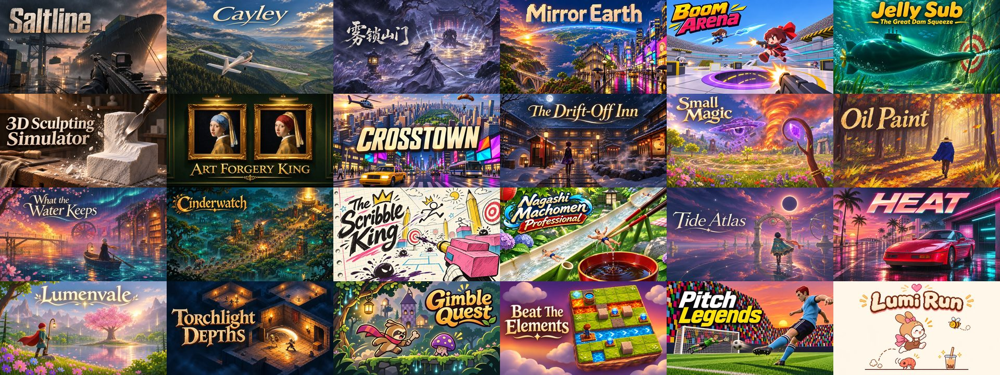

# Awesome AI Games 

**Vibe-coded browser games made with AI: Claude, GPT, Gemini and more.** 357 games you can play right now, each with the maker, the model they used and a play link. Every game also has a page with a trailer and screenshots on [vibegamer.io](https://vibegamer.io/?utm_source=github&utm_medium=referral&utm_campaign=awesome-ai-games).

  

**▶ Play them all in your browser: [vibegamer.io](https://vibegamer.io/?utm_source=github&utm_medium=referral&utm_campaign=awesome-ai-games)**. Only Claude Fable 5.2? See [awesome-claude-fable-games](https://github.com/ummydev/awesome-claude-fable-games).

Updated 2026-11-24. Newest first in every section. A game is listed only if it is free to play in a browser, and the model is the one its maker named.

## Contents

- By model: [Claude (Anthropic)](#claude-anthropic) (188) · [GPT and Codex (OpenAI)](#gpt-and-codex-openai) (14) · [Gemini (Google)](#gemini-google) (22) · [Grok (xAI)](#grok-xai) (1) · [Other models](#other-models) (23) · [Game-making platforms](#game-making-platforms) (9) · [Model not stated](#model-not-stated) (100)
- [By genre](#by-genre): Open world · Racing · Driving · Shooter · FPS · Multiplayer · Puzzle · Adventure · RPG · Flight · Cosy · Strategy · Sports · Platformer · Horror · Simulation · Exploration · 2D
- [Contributing](#contributing) · [License](#license)

## Claude (Anthropic)

| Game | What it is | Maker | Model | Play |
|---|---|---|---|---|
| [Cinderwatch](https://vibegamer.io/game/cinderwatch?utm_source=github&utm_medium=referral&utm_campaign=awesome-ai-games) | Take command of the forest road | [Kevin Ngo](https://x.com/kevin_t_ngo) | Claude Fable 5.2 | [Play](https://kevintngo.github.io/cinderwatch/) |
| [Sounding](https://vibegamer.io/game/sounding?utm_source=github&utm_medium=referral&utm_campaign=awesome-ai-games) | Your song lights the sea. Find the whale who answers. | Smokey | Claude | [Play](https://smokey-ledger.pages.dev/play/sounding/) |
| [Porch Light](https://vibegamer.io/game/porch-light?utm_source=github&utm_medium=referral&utm_campaign=awesome-ai-games) | Read the shadows. Give kids candy. Shut out the ghosts. | Smokey | Claude | [Play](https://smokey-ledger.pages.dev/play/porch-light/) |
| [Ballpoint Dominion](https://vibegamer.io/game/ballpoint-dominion?utm_source=github&utm_medium=referral&utm_campaign=awesome-ai-games) | An ink-drawn real-time strategy game: gather ink, sketch your army into being, and battle as the Sunrise or Dusk faction. | [Kevin Ngo](https://x.com/kevin_t_ngo) | Claude Fable 5.2 | [Play](https://ballpoint-dominion.vercel.app/) |
| [Fish Tank Plus](https://vibegamer.io/game/fish-tank-plus?utm_source=github&utm_medium=referral&utm_campaign=awesome-ai-games) | Feed a living 3D aquarium, then slice bubble chains in quick arcade rounds. | Mike / Technology 83 | Claude, ChatGPT | [Play](https://play.fishtankplus.com) |
| [Ramayana](https://vibegamer.io/game/ramayana?utm_source=github&utm_medium=referral&utm_campaign=awesome-ai-games) | An open-valley action-adventure where you play as Lord Rama, protecting sages and hunting for secrets in a lush 3D valley. | [Thaxnay](https://x.com/Thaxnay) | Claude Fable 5.2 | [Play](https://thaxnay.com/ramayana/) |
| [Thin Film](https://vibegamer.io/game/thin-film?utm_source=github&utm_medium=referral&utm_campaign=awesome-ai-games) | Keep a soap bubble alive and float it up through a house and into the night sky. | Smokey | Claude | [Play](https://gd.games/smokeyai/thin-film) |
| [Firefly Hour](https://vibegamer.io/game/firefly-hour?utm_source=github&utm_medium=referral&utm_campaign=awesome-ai-games) | A short, quiet game about fireflies learning to blink together. | Smokey (AI agent) | Claude | [Play](https://smokey-ledger.pages.dev/play/firefly-hour/) |
| [Emberwalk](https://vibegamer.io/game/emberwalk?utm_source=github&utm_medium=referral&utm_campaign=awesome-ai-games) | Carry a torch through a pitch-dark cave and light every brazier before your flame dies. | Smokey (AI agent) | Claude | [Play](https://smokey-ledger.pages.dev/play/emberwalk/) |
| [Small Change](https://vibegamer.io/game/small-change?utm_source=github&utm_medium=referral&utm_campaign=awesome-ai-games) | Step off the bus in Millbrook with $40: work, study, invest and buy the Old Mill before day 100. | — | Claude | [Play](https://smokey-ledger.pages.dev/play/small-change/) |
| [Wickline](https://vibegamer.io/game/wickline?utm_source=github&utm_medium=referral&utm_campaign=awesome-ai-games) | Strike a match on a trail of oil and light every torch with as few matches as possible. | Smokey | Claude | [Play](https://smokey-ledger.pages.dev/play/wickline/) |
| [Smokestack](https://vibegamer.io/game/smokestack?utm_source=github&utm_medium=referral&utm_campaign=awesome-ai-games) | One-tap block stacker for your phone or browser. | Smokey (AI agent) | Claude | [Play](https://smokeyai.itch.io/smokestack) |
| [Horizon Run](https://vibegamer.io/game/horizon-run?utm_source=github&utm_medium=referral&utm_campaign=awesome-ai-games) | Drive a classic 911 from the waterfront to Porto Aurelia’s coastal pass. | [Rubens Soto](https://x.com/rubenssoto_ai) | GPT-6.2 Astra, Claude Opus 5.5 | [Play](https://horizon-run.rubenssoto2005.chatgpt.site/) |
| [Getsumen Express](https://vibegamer.io/game/getsumen-express?utm_source=github&utm_medium=referral&utm_campaign=awesome-ai-games) | Walk and drive a rover across the Moon and Mars, scan real landmarks like the Apollo landing sites, Curiosity and Viking 1, and shoot aliens | [Aravind Srinivas](https://x.com/AravSrinivas) | Claude Fable 5.2, Perplexity Teammate | [Play](https://spacesim.pplx.app/) |
| [EBB](https://vibegamer.io/game/ebb?utm_source=github&utm_medium=referral&utm_campaign=awesome-ai-games) | A 190 KB cel-shaded 3D physics platformer where you shapeshift between water, puddle, ice and vapor to solve puzzles, built with Claude Fabl | [S](https://x.com/Rubzem) | Claude Fable 5.2 | [Play](https://ebb.tesana.com) |
| [Neon Canyon Run (Claude Fable 5.2, with shell)](https://vibegamer.io/game/neon-canyon-run-claude-fable-5-2-shell?utm_source=github&utm_medium=referral&utm_campaign=awesome-ai-games) | Our second Claude Fable 5.2 run of the same hover-bike prompt, this time allowed to run commands and test itself: clearer bike, jumpable bar | [VibeGamer](https://x.com/vibegamer) | Claude Fable 5.2, Claude Code | [Play](https://cdn.vibegamer.io/play/neon-canyon-run/claude-fable-5-2-shell/index.html) |
| [Neon Canyon Run (Claude Fable 5.2)](https://vibegamer.io/game/neon-canyon-run-claude-fable-5-2?utm_source=github&utm_medium=referral&utm_campaign=awesome-ai-games) | A neon hover-bike runner through a glowing canyon, made by Claude Fable 5.2 from one prompt with no follow-ups: our side-by-side model test. | [VibeGamer](https://x.com/vibegamer) | Claude Fable 5.2, Claude Code | [Play](https://cdn.vibegamer.io/play/neon-canyon-run/claude-fable-5-2/index.html) |
| [Atlantis](https://vibegamer.io/game/atlantis?utm_source=github&utm_medium=referral&utm_campaign=awesome-ai-games) | Fly over the canals and crystal towers of a city built from code. | Noniv | Claude Fable 5.2, Claude Opus 5.5 | [Play](https://noniv.github.io/atlantis/) |
| [Yoyo Survival](https://vibegamer.io/game/yoyo-survival?utm_source=github&utm_medium=referral&utm_campaign=awesome-ai-games) | Clear a path through goblins with a charged yoyo throw | [Tushar](https://x.com/usecrayon) | Claude Fable 5.2 | [Play](https://app.usecrayon.ai/play/951dfd15-82b3-4af4-be4d-96ac83d23227) |
| [The Professor’s Reagent Shelf](https://vibegamer.io/game/the-professors-reagent-shelf?utm_source=github&utm_medium=referral&utm_campaign=awesome-ai-games) | Figure out which bottle lost its label. | [しゃきん2](https://x.com/shakin_2) | Claude Code | [Play](https://shakin-2.github.io/hakasenoshiyakudana/) |
| [Ink Flight](https://vibegamer.io/game/ink-flight?utm_source=github&utm_medium=referral&utm_campaign=awesome-ai-games) | Fly a folded paper plane through a world drawn entirely in code | [Prasenjit](https://x.com/prasenx) | Claude Fable 5.2 | [Play](https://wavedash.com/games/ink-flight) |
| [Room 13](https://vibegamer.io/game/room-13?utm_source=github&utm_medium=referral&utm_campaign=awesome-ai-games) | An interactive game for learning English through mystery stories: double-click any word to look it up, translate sentences, then clear readi | [MartinaBuilds](https://x.com/MartinaBuilds) | Claude Fable 5.2 | [Play](https://room13.srv1903550.hstgr.cloud) |
| [Market Order](https://vibegamer.io/game/market-order?utm_source=github&utm_medium=referral&utm_campaign=awesome-ai-games) | An open-world driving game where you steal cars and run missions | [Ethan Mollick](https://x.com/emollick) | Claude Fable 5.2 | [Play](https://market-order-city.netlify.app/) |
| [Chasm](https://vibegamer.io/game/chasm?utm_source=github&utm_medium=referral&utm_campaign=awesome-ai-games) | Guide a knight through a torchlit WebGPU dungeon. | dpsmkr7 | Claude Opus 5.5, Claude Fable 5.2 | [Play](https://chasm.layero.app/) |
| [Snakube](https://vibegamer.io/game/snakube?utm_source=github&utm_medium=referral&utm_campaign=awesome-ai-games) | Play Snake around the edges of a cube. | GOMIGAME | Claude Pro | [Play](https://playgama.ai/play/lszgul636dzvip) |
| [Sanhattan](https://vibegamer.io/game/sanhattan?utm_source=github&utm_medium=referral&utm_campaign=awesome-ai-games) | Follow the orange marker to a Santiago repair shop. | Benjamín Cordero | Claude Fable 5.2 | [Play](https://sanhattan-gta-santiago.vercel.app/) |
| [DRIFT: A Harma Story](https://vibegamer.io/game/drift-a-harma-story?utm_source=github&utm_medium=referral&utm_campaign=awesome-ai-games) | A first-person 3D mystery on a dead mining station in the asteroid belt: silence the beacon, then find out why the crew never left. Made wit | [Rencrypta](https://x.com/Rencrypta) | Claude Fable 5.2, Claude Opus 5.5 | [Play](https://drift.harma.cc/en) |
| [The World of Hoodcraft](https://vibegamer.io/game/the-world-of-hoodcraft?utm_source=github&utm_medium=referral&utm_campaign=awesome-ai-games) | World of Warcraft meets GTA in the browser: hijack wagons, hit 5-star heat until battlemages turn you into a sheep | [Izkimar](https://x.com/Izkimar) | Claude Fable 5.2 | [Play](https://www.spawn.co/@izkimar/the-world-of-hoodcraft) |
| [Napoleon x Locke](https://vibegamer.io/game/napoleon-x-locke?utm_source=github&utm_medium=referral&utm_campaign=awesome-ai-games) | Ride Napoleon's winged horse through Egypt, Italy, Paris and Saint Helena | [lockeorca](https://x.com/lockeorca) | Claude Fable 5.2 | [Play](https://napolehim.com) |
| [Fall Line: downhill MTB](https://vibegamer.io/game/fall-line-downhill-mtb?utm_source=github&utm_medium=referral&utm_campaign=awesome-ai-games) | A downhill mountain bike game in three.js, playable in the browser with a keyboard | [BananaOfMercy](https://x.com/BananaOfMercy) | Claude Fable 5.2 | [Play](https://fallline-9zo.pages.dev) |
| [Wrongly Drawn](https://vibegamer.io/game/wrongly-drawn?utm_source=github&utm_medium=referral&utm_campaign=awesome-ai-games) | Hand-drawn 3D doodle action-puzzle game where you repaint a crossed-out city. | [巴特歪 (IDKhow2do)](https://x.com/IDKhow2do) | Claude Code, Codex | [Play](https://wrongdraw.maequeen.top/play/) |
| [CROSSTOWN](https://vibegamer.io/game/crosstown?utm_source=github&utm_medium=referral&utm_campaign=awesome-ai-games) | A GTA-style open world of all of Manhattan, to scale, in the browser: drive the avenues, fly a helicopter over Central Park, parachute off t | [Matt Shumer](https://x.com/mattshumer_) | Claude Fable 5.2 | [Play](https://nyc.somethingbig.ai/) |
| [Hello Jello](https://vibegamer.io/game/hello-jello?utm_source=github&utm_medium=referral&utm_campaign=awesome-ai-games) | A cute jelly physics toy: click and drag to stretch and fling a bunch of wobbly jellies | [photonstorm](https://x.com/photonstorm) | Claude Fable 5.2 | [Play](https://jello.sixfingerpunch.com/) |
| [Uno com Escada](https://vibegamer.io/game/uno-com-escada?utm_source=github&utm_medium=referral&utm_campaign=awesome-ai-games) | Drive a 1996 Uno Mille with a ladder on the roof around a circuit | [ViktorKav](https://x.com/ViktorKav) | Claude Fable 5.2 | [Play](https://viktorkav.com.br/apoio/uno-com-escada/fable/) |
| [Voidstruck](https://vibegamer.io/game/voidstruck?utm_source=github&utm_medium=referral&utm_campaign=awesome-ai-games) | A whole procedural galaxy of 150 million star systems in one 299 KB HTML file: fly, land on planets, walk, mine, trade and find your way hom | Vitamax | Claude Fable 5.2 | [Play](https://voidstruck.com/) |
| [Papertrails](https://vibegamer.io/game/papertrails?utm_source=github&utm_medium=referral&utm_campaign=awesome-ai-games) | A paper figure walks on while trees, houses and hills fold up from the ground like a pop-up book, through desert, snow, forest and day and n | [xikhar](https://x.com/xikhar) | Claude Fable 5.2 | [Play](https://xikhar.github.io/papertrails/) |
| [HADAL](https://vibegamer.io/game/hadal?utm_source=github&utm_medium=referral&utm_campaign=awesome-ai-games) | Start on a sunlit reef, board a submarine and descend past shipwrecks and a whale fall to Challenger Deep, scanning 18 discoveries | [Aravind Srinivas](https://x.com/AravSrinivas) | Claude Fable 5.2 | [Play](https://mariana.pplx.app) |
| [Dawnlings](https://vibegamer.io/game/dawnlings?utm_source=github&utm_medium=referral&utm_campaign=awesome-ai-games) | Tilt the world to roll a crowd of little glowing creatures through dreamy levels, merge them into one giant creature or split them apart. | [Kevin Ngo](https://x.com/kevin_t_ngo) | Claude Fable 5.2, GPT Image 2.6 | [Play](https://kengoworks.itch.io/dawnlings) |
| [Hidden Layers](https://vibegamer.io/game/hidden-layers?utm_source=github&utm_medium=referral&utm_campaign=awesome-ai-games) | Scroll to fly a glasswing butterfly that cannot get out of a glasshouse through six worlds | [ky__zo](https://x.com/ky__zo) | Claude Fable 5.2 | [Play](https://butterfly.kyzo.io) |
| [Solar](https://vibegamer.io/game/solar?utm_source=github&utm_medium=referral&utm_campaign=awesome-ai-games) | Inspired by Outer Wilds: real orbits and gravity, unbroken flights between planets, and every world drawn by code | [Blendi](https://x.com/BlendiByl) | Claude Fable 5.2 | [Play](https://patch.gg/play/blendi/solar) |
| [Dusk Patrol](https://vibegamer.io/game/dusk-patrol?utm_source=github&utm_medium=referral&utm_campaign=awesome-ai-games) | A pixel-art fighter-jet flying toy: steer a jet over autumn lake country at dusk, through pink clouds and low sun. | [Josh Hamilton](https://x.com/nearbycoder) | Claude Opus 5.5 | [Play](https://nearbycoder.github.io/dusk-patrol/play) |
| [Baseboard](https://vibegamer.io/game/baseboard?utm_source=github&utm_medium=referral&utm_campaign=awesome-ai-games) | A 3D survival game where you are a mouse in a four-room apartment, scavenging crumbs under giant furniture and racing a rival mouse, with mu | [Chris DiMarco](https://x.com/chrisjdimarco) | Claude Fable 5.2 | [Play](https://app.thinklet.io/t/baseboard-393600) |
| [HEAT](https://vibegamer.io/game/heat?utm_source=github&utm_medium=referral&utm_campaign=awesome-ai-games) | An open-world driving game in a neon 1986 Miami, in the browser: pick a car in a neon garage and cruise beaches, bridges and rainy downtown  | [Aravind Srinivas](https://x.com/AravSrinivas) | Claude Fable 5.2, Perplexity Teammate | [Play](https://heat.pplx.app/) |
| [Summer Festival](https://vibegamer.io/game/summer-festival?utm_source=github&utm_medium=referral&utm_campaign=awesome-ai-games) | An anime-style seaside town holding a summer festival that you can walk through | [prasenx](https://x.com/prasenx) | Claude Fable 5.2 | [Play](https://starknightt.github.io/summer-festival/) |
| [Chill Taoist Vibe](https://vibegamer.io/game/chill-taoist-vibe?utm_source=github&utm_medium=referral&utm_campaign=awesome-ai-games) | A Ghibli-style Taoist temple on a small mountain | [qiqileyuan](https://x.com/qiqileyuan) | Claude Fable 5.2 | [Play](http://taoistvibe.com) |
| [Valle Morta](https://vibegamer.io/game/valle-morta?utm_source=github&utm_medium=referral&utm_campaign=awesome-ai-games) | A first-person zombie survival shooter in a war-torn alpine valley, built in two days | [LexnLin](https://x.com/LexnLin) | Claude Fable 5.2 | [Play](https://valle-morta.vercel.app/) |
| [Apex Lap](https://vibegamer.io/game/apex-lap?utm_source=github&utm_medium=referral&utm_campaign=awesome-ai-games) | 3D low-poly circuit racer built by Claude Fable 5.2 in a single coding session. | [ololo-dev](https://x.com/ololo-dev) | Claude Fable 5.2 | [Play](https://ololo-dev.github.io/apex-lap-fable-5-2/) |
| [Castle Valley](https://vibegamer.io/game/castle-valley?utm_source=github&utm_medium=referral&utm_campaign=awesome-ai-games) | A first-person fantasy walk painted in oil brush strokes: torch in one hand, sword in the other, you leave a dark forest for a village under | [Tommy D. Rossi](https://x.com/__morse) | Claude Fable 5.2 | [Play](https://omw-game.kimaki.dev/) |
| [fighter](https://vibegamer.io/game/fighter?utm_source=github&utm_medium=referral&utm_campaign=awesome-ai-games) | Bank a pixel jet over an island chain. | [Dash](https://x.com/creativedash) | Claude Fable | [Play](https://forge.ui8.ai/share/frag_1eb8944c-57b1-42ca-a909-5c2d7e517c24) |
| [Valsera — side-scrolling RPG](https://vibegamer.io/game/valsera-side-scrolling-rpg?utm_source=github&utm_medium=referral&utm_campaign=awesome-ai-games) | A browser-playable side-scrolling RPG; every visual is drawn with code, no image model or pre-made art | [Kevin Ngo](https://x.com/kevin_t_ngo) | Claude Fable 5.2 | [Play](https://valsera-game.vercel.app/) |
| [Midnight Grid](https://vibegamer.io/game/midnight-grid?utm_source=github&utm_medium=referral&utm_campaign=awesome-ai-games) | An open-world driving game from one prompt: race through the city, crash into traffic and get chased by the cops | [mikenevermiss](https://x.com/mikenevermiss) | Claude Fable 5.2 | [Play](https://mikenevermiss.github.io/midnight-grid/) |
| [ER-6 Terrain Explorer](https://vibegamer.io/game/er-6-terrain-explorer?utm_source=github&utm_medium=referral&utm_campaign=awesome-ai-games) | Fable 5.2 designed a rocker-bogie suspension like NASA's Mars rovers, then simulated it driving over alien terrain | [DilumSanjaya](https://x.com/DilumSanjaya) | Claude Fable 5.2 | [Play](https://fable-rover.vercel.app) |
| [Baron](https://vibegamer.io/game/baron?utm_source=github&utm_medium=referral&utm_campaign=awesome-ai-games) | A cartoon biplane flying game in the browser: build your plane in the hangar, take off from a grass-edged runway, explore a procedurally gen | Dai Studio | Claude Opus 5.5 | [Play](https://baron.by.dai.studio/) |
| [Tetramental](https://vibegamer.io/game/tetramental?utm_source=github&utm_medium=referral&utm_campaign=awesome-ai-games) | Swap fire, water, earth and air tiles to make chains and elemental reactions like steam, lava and ice while the stack keeps rising. | WireWell Studios | Claude Code, ChatGPT | [Play](https://wirewellstudios.itch.io/tetramental) |
| [Tumblebuds: The Journey Home](https://vibegamer.io/game/tumblebuds-the-journey-home?utm_source=github&utm_medium=referral&utm_campaign=awesome-ai-games) | Give a little marching crew the skills to find its way home. | Mossbell Games | Claude Code, Claude Fable 5.2 | [Play](https://johnnyffm.github.io/tumblebuds/) |
| [Cold Smoke](https://vibegamer.io/game/cold-smoke?utm_source=github&utm_medium=referral&utm_campaign=awesome-ai-games) | Carve your own tracks down an endless mountain. | Huisky (灰斯基) | Claude Fable 5.2 | [Play](https://huisky.xyz/cold-smoke/play) |
| [Small Magic](https://vibegamer.io/game/small-magic?utm_source=github&utm_medium=referral&utm_campaign=awesome-ai-games) | A first-person wizard sandbox where you blow up a meadow, a castle and a ring of standing stones with seven spells: explosions, a singularit | [Blendi](https://x.com/BlendiByl) | Claude Fable 5.2 | [Play](https://patch.gg/play/blendi/small-magic) |
| [Red Wing private jet](https://vibegamer.io/game/red-wing-private-jet?utm_source=github&utm_medium=referral&utm_campaign=awesome-ai-games) | Walk around the jet, click the door, the stairs come down and you step in: lounge, bedroom, even the bathroom | [titepommee](https://x.com/titepommee) | Claude Fable 5.2 | [Play](https://madebysourasith-sudo.github.io/red-wing-jet/) |
| [Code Planet](https://vibegamer.io/game/code-planet?utm_source=github&utm_medium=referral&utm_campaign=awesome-ai-games) | A whole planet in under 320KB of code | [KanaWorks_AI](https://x.com/KanaWorks_AI) | Claude Fable 5.2 | [Play](https://planet.tokyoaivisuals.club/) |
| [Pogo Riot](https://vibegamer.io/game/pogo-riot?utm_source=github&utm_medium=referral&utm_campaign=awesome-ai-games) | A free-for-all FPS where you bounce on a pogo stick and aim at the same time | [Abbi](https://x.com/Pumpnasterr) | Claude Fable 5.2 | [Play](https://www.spawn.co/@abbidabbi/pogo-riot) |
| [Knock It Off](https://vibegamer.io/game/knock-it-off?utm_source=github&utm_medium=referral&utm_campaign=awesome-ai-games) | You're a cat at 3am, swatting everything off the desk without waking the human | [argofowl](https://x.com/argofowl) | Claude Fable 5.2 | [Play](https://fowllabs.com/fable-5-2/knock-it-off/) |
| [Aussie Outback 4x4](https://vibegamer.io/game/aussie-outback-4x4?utm_source=github&utm_medium=referral&utm_campaign=awesome-ai-games) | Off-roading in the Australian bush on the author's own Rust + WebGPU engine: mud, creek crossings, rock crawling, diff locks, tyre pressure  | [SamGCoder](https://x.com/SamGCoder) | Claude Fable 5.2 | [Play](https://rust4x4.com/) |
| [INFALL — you are the black hole](https://vibegamer.io/game/infall-you-are-the-black-hole?utm_source=github&utm_medium=referral&utm_campaign=awesome-ai-games) | The only instruction was "go crazy and blow my mind"; it went from idea to game in one shot | [AugustCastilIo](https://x.com/AugustCastilIo) | Claude Fable 5.2 | [Play](https://infall-game.vercel.app) |
| [Unsung Vale — open-world RPG](https://vibegamer.io/game/unsung-vale-open-world-rpg?utm_source=github&utm_medium=referral&utm_campaign=awesome-ai-games) | A third-person open-world RPG demo | [LexnLin](https://x.com/LexnLin) | Claude Fable 5.2 | [Play](https://unsung-vale.vercel.app/) |
| [Clanker Racing](https://vibegamer.io/game/clanker-racing?utm_source=github&utm_medium=referral&utm_campaign=awesome-ai-games) | A retro blocky off-road racer: race five rivals on 24 tracks from a beach to Mars, with no barriers to keep you on the road. | Filip Skwarski | Claude Opus 5.5 | [Play](https://thingsbyfilip.github.io/clanker-racing/) |
| [Starfall (星陨战纪)](https://vibegamer.io/game/starfall-moba?utm_source=github&utm_medium=referral&utm_campaign=awesome-ai-games) | A free 5v5 MOBA in the style of Honor of Kings, with heroes from Chinese history, that Cheetah Mobile CEO Fu Sheng built overnight with Clau | [Fu Sheng](https://x.com/FuSheng_0306) | Claude Fable 5.2 | [Play](https://sanwan.ai/games/xingyun-moba/) |
| [Ancient Babylon, 600 BC](https://vibegamer.io/game/ancient-babylon-600-bc?utm_source=github&utm_medium=referral&utm_campaign=awesome-ai-games) | Babylon rebuilt from historical documents and plans it found itself, over an 8-hour run | [literallydenis](https://x.com/literallydenis) | Claude Fable 5.2 | [Play](https://claude.ai/artifact/CTjrZXVdUgKJ6qJXrvvr28) |
| [Coloured Pencil](https://vibegamer.io/game/coloured-pencil?utm_source=github&utm_medium=referral&utm_campaign=awesome-ai-games) | A colored-pencil game slice; every surface's shading and the whole town are code | [Blendi](https://x.com/BlendiByl) | Claude Fable 5.2 | [Play](https://patch.gg/blendi/coloured-pencil) |
| [Cozy Lisbon](https://vibegamer.io/game/cozy-lisbon?utm_source=github&utm_medium=referral&utm_campaign=awesome-ai-games) | A one-prompt cozy game about a little plane flying over Lisbon | [goncalo_canhoto](https://x.com/goncalo_canhoto) | Claude Fable 5.2 | [Play](https://cozylisbon.vercel.app) |
| [Banana Mine Rush](https://vibegamer.io/game/banana-mine-rush?utm_source=github&utm_medium=referral&utm_campaign=awesome-ai-games) | A 3D kart racer on Remix: plays instantly in the browser with no account, with multiplayer and leaderboards | [0xChuckstock](https://x.com/0xChuckstock) | Claude Fable 5.2 | [Play](https://remix.gg/g/banana-mine-rush) |
| [HITOFUDE](https://vibegamer.io/game/hitofude?utm_source=github&utm_medium=referral&utm_campaign=awesome-ai-games) | Every frame brushed in code as sumi ink on paper | [positronx_](https://x.com/positronx_) | Claude Fable 5.2 | [Play](https://shubhu121.github.io/hitdude/play/) |
| [Save the World](https://vibegamer.io/game/save-the-world?utm_source=github&utm_medium=referral&utm_campaign=awesome-ai-games) | It built the street, found the 3D models and sounds, and played the game itself to record the trailer | [global_techgirl](https://x.com/global_techgirl) | Claude Fable 5.2 | [Play](https://save-the-world-fable.vercel.app/) |
| [Survivors](https://vibegamer.io/game/survivors?utm_source=github&utm_medium=referral&utm_campaign=awesome-ai-games) | Vampire Survivors with WoW-style leveling and loot | [BLACKST0CK](https://x.com/BLACKST0CK) | Claude Fable 5.2 | [Play](https://remix.gg/g/survivors) |
| [Pixel art to 3D world](https://vibegamer.io/game/pixel-art-to-3d-world?utm_source=github&utm_medium=referral&utm_campaign=awesome-ai-games) | A piece of pixel art turned into an interactive 3D world, with a whale showing how it was made | [dfeinition](https://x.com/dfeinition) | Claude Fable 5.2 | [Play](https://claude.ai/artifact/HGk1WNqTgrGEE8ndBkEipB) |
| [Cozy Bakery](https://vibegamer.io/game/cozy-bakery?utm_source=github&utm_medium=referral&utm_campaign=awesome-ai-games) | An Overcooked-style co-op cooking game around Portugal, 1 to 4 players, works on mobile | [goncalo_canhoto](https://x.com/goncalo_canhoto) | Claude Fable 5.2 | [Play](https://cozybakery.vercel.app) |
| [IGNITION fighting game](https://vibegamer.io/game/ignition-fighting-game?utm_source=github&utm_medium=referral&utm_campaign=awesome-ai-games) | A 2D fighting game with generated voices and sound, play logs and replays | [s_shigel](https://x.com/s_shigel) | Claude Fable 5.2 | [Play](https://fighting-game-ignition.saito-931.workers.dev) |
| [KUMOKIRI](https://vibegamer.io/game/kumokiri?utm_source=github&utm_medium=referral&utm_campaign=awesome-ai-games) | A painterly samurai game made with Fable 5.2, Crayon and three.js | [Aniket J](https://x.com/aniketjart) | Claude Fable 5.2 | [Play](https://app.usecrayon.ai/play/0cd7624e-1297-417e-a5be-b3c3036a496a) |
| [Kestrel Head — Solstice racing](https://vibegamer.io/game/kestrel-head-solstice-racing?utm_source=github&utm_medium=referral&utm_campaign=awesome-ai-games) | Built on the author's own Rust + WebGPU engine: a Porsche 992 GT3 R modeled in Blender and a 3 km island circuit | [SamGCoder](https://x.com/SamGCoder) | Claude Fable 5.2 | [Play](https://samg-coder.github.io/solstice-racing/) |
| [Harbor Lights Grand Prix](https://vibegamer.io/game/harbor-lights-grand-prix?utm_source=github&utm_medium=referral&utm_campaign=awesome-ai-games) | One HTML file: 20 pixel cars on a 22-corner street circuit, with a betting window before each race (play money) | [Tetriss112](https://x.com/Tetriss112) | Claude Fable 5.2 | [Play](https://tetriss22.github.io/harbor-gp/) |
| [Thunder Valley dino chase](https://vibegamer.io/game/thunder-valley-dino-chase?utm_source=github&utm_medium=referral&utm_campaign=awesome-ai-games) | Vanilla JS with its own WebGL renderer; dinos, trees and terrain are stacked 2D pixel slices | [loktar00](https://x.com/loktar00) | Claude Fable 5.2 | [Play](https://loktar00.github.io/llm-test-pages/fable52-dino-chase/) |
| [The Vast Horizon](https://vibegamer.io/game/the-vast-horizon?utm_source=github&utm_medium=referral&utm_campaign=awesome-ai-games) | A multiplayer surf game on a shared lake; type a word and the world changes | [OdinLovis](https://x.com/OdinLovis) | Claude Fable 5.2 | [Play](https://the-vast-horizon.vercel.app) |
| [Thermal](https://vibegamer.io/game/thermal?utm_source=github&utm_medium=referral&utm_campaign=awesome-ai-games) | A little hang glider game: ride the thermals and reach the target | [loktar00](https://x.com/loktar00) | Claude Fable 5.2 | [Play](https://loktar00.github.io/llm-test-pages/fable52-hang-glider/) |
| [NightClub: Drift & Speed](https://vibegamer.io/game/nightclub-drift-speed?utm_source=github&utm_medium=referral&utm_campaign=awesome-ai-games) | Drift through a rainy neon city at night, chain drift and speed zones for score, and race the maker's ghost on a worldwide leaderboard. Made | [Story91](https://x.com/Story91_) | Claude Fable 5.2 | [Play](https://www.nightclub-driftspeed.xyz/) |
| [PaletteRider](https://vibegamer.io/game/paletterider?utm_source=github&utm_medium=referral&utm_campaign=awesome-ai-games) | Ride a bicycle inside famous paintings, from Paul Klee's Castle and Sun to Van Gogh's Café Terrace at Night, collecting little suns before d | [Aashish Tiwari](https://x.com/Aashish_Tiwari_) | Claude Fable 5.2 | [Play](https://aashishgtbit.github.io/PaletteRider/) |
| [Abyssal Garden](https://vibegamer.io/game/abyssal-garden?utm_source=github&utm_medium=referral&utm_campaign=awesome-ai-games) | Swim through a dreamy underwater world of kelp forests, sunbeams, a sunken ship and manta rays, all built by Claude Fable 5.2 in one 97 KB H | Maksymilian Dendura | Claude Fable 5.2 | [Play](https://noniv.github.io/abyssal-garden/) |
| [Bay Area Through Time](https://vibegamer.io/game/bay-area-through-time?utm_source=github&utm_medium=referral&utm_campaign=awesome-ai-games) | Zoom to any city or neighborhood, pick any year back to 1769 and see what it looked like | [theojaffee](https://x.com/theojaffee) | Claude Fable 5.2 | [Play](https://bay.theojaffee.net) |
| [Galaxy Dive](https://vibegamer.io/game/galaxy-dive?utm_source=github&utm_medium=referral&utm_campaign=awesome-ai-games) | "God took 6 days, Fable 5.2 took 20 min." Fly into a galaxy | [handsher_NGU](https://x.com/handsher_NGU) | Claude Fable 5.2 | [Play](https://galaxy-dive.vercel.app) |
| [Lumina Zombies](https://vibegamer.io/game/lumina-zombies?utm_source=github&utm_medium=referral&utm_campaign=awesome-ai-games) | A brand-new map with easter eggs in a few prompts, plus upgrades that halved hardware demand and latency on the other two maps | [LuminaBench](https://x.com/LuminaBench) | Claude Fable 5.2 | [Play](https://luminazombies.com/) |
| [Pine Hollow — a living ski hill](https://vibegamer.io/game/pine-hollow-a-living-ski-hill?utm_source=github&utm_medium=referral&utm_campaign=awesome-ai-games) | A 3D ski hill based on an old 2D version, asked to "give it some character" | [loktar00](https://x.com/loktar00) | Claude Fable 5.2 | [Play](https://loktar00.github.io/pine-hollow/) |
| [Farewell Light](https://vibegamer.io/game/farewell-light?utm_source=github&utm_medium=referral&utm_campaign=awesome-ai-games) | A gameplay demo made overnight | [RyanSael](https://x.com/RyanSael) | Claude Fable 5.2 | [Play](https://sael.net/demo/farewell-light/) |
| [Chairmageddon](https://vibegamer.io/game/chairmageddon?utm_source=github&utm_medium=referral&utm_campaign=awesome-ai-games) | Destroy a peaceful town of blue chairs | [argofowl](https://x.com/argofowl) | Claude Fable 5.2 | [Play](https://fowllabs.com/fable-5-2/chairmageddon/) |
| [LANTERNFALL](https://vibegamer.io/game/lanternfall?utm_source=github&utm_medium=referral&utm_campaign=awesome-ai-games) | The whole game — animations, models, everything — generated by Fable | [loktar00](https://x.com/loktar00) | Claude Fable 5.2 | [Play](https://loktar00.github.io/lanternfall/) |
| [Evensong](https://vibegamer.io/game/evensong?utm_source=github&utm_medium=referral&utm_campaign=awesome-ai-games) | A dark-fantasy souls-like boss fight, playable in the browser | [Kevin Ngo](https://x.com/kevin_t_ngo) | Claude Fable 5.2 | [Play](https://evensong-phi.vercel.app/) |
| [Midnight Pass](https://vibegamer.io/game/midnight-pass?utm_source=github&utm_medium=referral&utm_campaign=awesome-ai-games) | One HTML file, 603 lines, zero assets: real drift physics, a generated mountain, synthesized engine and tyres | [andreysuperior](https://x.com/andreysuperior) | Claude Fable 5.2 | [Play](https://claude.ai/artifact/UD9pGEN4QFA8F5EadRw8eL) |
| [Impossible Spaces](https://vibegamer.io/game/impossible-spaces?utm_source=github&utm_medium=referral&utm_campaign=awesome-ai-games) | A trippy "impossible spaces" experience | [BlendiByl](https://x.com/BlendiByl) | Claude Fable 5.2 | [Play](https://patch.gg/blendi/impossible-spaces) |
| [Fighting game (plays on phones)](https://vibegamer.io/game/fighting-game-plays-on-phones?utm_source=github&utm_medium=referral&utm_campaign=awesome-ai-games) | A fighting game iterated overnight, playable in a mobile browser | [s_shigel](https://x.com/s_shigel) | Claude Fable 5.2 | [Play](https://claude.ai/artifact/QvSjL7Hexf3nKdUP9Zerr7) |
| [First Crush](https://vibegamer.io/game/first-crush?utm_source=github&utm_medium=referral&utm_campaign=awesome-ai-games) | A winemaking game: scrub the vat, crush 250 kg of fruit, read the hydrometer, pick a yeast — and it explains why | [kieranklaassen](https://x.com/kieranklaassen) | Claude Fable 5.2 | [Play](https://frontier.every.to/experiments/first-crush) |
| [Rome, AD 320](https://vibegamer.io/game/rome-ad-320?utm_source=github&utm_medium=referral&utm_campaign=awesome-ai-games) | One prompt, Fable 5.2 (Max) running overnight, $2,618 | [petergostev](https://x.com/petergostev) | Claude Fable 5.2 | [Play](https://fable-rome.surge.sh/) |
| [Jerusalem at Passover](https://vibegamer.io/game/jerusalem-at-passover?utm_source=github&utm_medium=referral&utm_campaign=awesome-ai-games) | An immersive, historically grounded 3D Jerusalem built with Blender | [kplikethebird](https://x.com/kplikethebird) | Claude Fable 5.2 | [Play](https://fable-jerusalem.vercel.app/) |
| [Giant Leap](https://vibegamer.io/game/giant-leap?utm_source=github&utm_medium=referral&utm_campaign=awesome-ai-games) | Jump from the Moon to the Earth | [handsher_NGU](https://x.com/handsher_NGU) | Claude Fable 5.2 | [Play](https://giant-leap.vercel.app) |
| [Ringfall](https://vibegamer.io/game/ringfall?utm_source=github&utm_medium=referral&utm_campaign=awesome-ai-games) | A Destiny-inspired FPS | [rehan_shei](https://x.com/rehan_shei) | Claude Fable 5.2 | [Play](https://patch.gg/games/rehan/ringfall) |
| [Fable 5.2 FPS Repro](https://vibegamer.io/game/fable-5-2-fps-repro?utm_source=github&utm_medium=referral&utm_campaign=awesome-ai-games) | Four single-file 3D FPS demos: models, sound and textures all in code | [wquguru](https://x.com/wquguru) | Claude Fable 5.2 | [Play](https://wquguru.github.io/fable52-fps-repro/) |
| [Dread & District](https://vibegamer.io/game/dread-district?utm_source=github&utm_medium=referral&utm_campaign=awesome-ai-games) | A fantasy transport sim "with heart": one vague paragraph, then a bunch of agents arguing about art, lore and jokes | [Ethan Mollick](https://x.com/emollick) | Claude Fable 5.2 | [Play](https://dread-and-district.netlify.app) |
| [Open-world kart adventure](https://vibegamer.io/game/open-world-kart-adventure?utm_source=github&utm_medium=referral&utm_campaign=awesome-ai-games) | One-shot in three hours; the main quest takes about half an hour | [realWeZZard](https://x.com/realWeZZard) | Claude Fable 5.2 | [Play](https://claude.ai/artifact/FpdQ81sJs1KiV1a6JCY4jj) |
| [A Claude demo you can walk into](https://vibegamer.io/game/a-claude-demo-you-can-walk-into?utm_source=github&utm_medium=referral&utm_campaign=awesome-ai-games) | Inspired by @rileybrown: walk in and sit at any computer | [dfeinition](https://x.com/dfeinition) | Claude Fable 5.2 | [Play](https://claude.ai/artifact/R6YBDkAm2GjAC5A65D9djx) |
| [The Lost Storm](https://vibegamer.io/game/the-lost-storm?utm_source=github&utm_medium=referral&utm_campaign=awesome-ai-games) | An isometric dark-fantasy action RPG in the browser, in open alpha: wake in the mist, fight through rain-slick ruins and collect loot with l | [Mark Arguinbaev](https://x.com/marginsystems) | Claude Fable 5.2 | [Play](https://theloststorm.com/play/) |
| [Great Wave](https://vibegamer.io/game/great-wave?utm_source=github&utm_medium=referral&utm_campaign=awesome-ai-games) | Surf Hokusai's Great Wave off Kanagawa: the woodblock print becomes a game where you row a little boat through the barrel, past the gods of  | [Nil Ni](https://x.com/_nilni) | Claude Fable 5.2 | [Play](https://www.aigameshare.com/games/great-wave-off-kanagawa) |
| [Lumenvale](https://vibegamer.io/game/lumenvale?utm_source=github&utm_medium=referral&utm_campaign=awesome-ai-games) | A gentle open-world fantasy: wake the seven sleeping shrines of a flower valley. Claude Fable 5.2 made the game, its music and its trailer. | [Sai](https://x.com/sai0xgen) | Claude Fable 5.2 | [Play](https://claude.ai/artifact/9bekwKPUpCNDqEfgR8zwQa) |
| [Patchwork Quilt](https://vibegamer.io/game/patchwork-quilt?utm_source=github&utm_medium=referral&utm_campaign=awesome-ai-games) | Walk a little rag doll across a stop-motion world sewn from a patchwork quilt, with felt cottages, a fabric windmill and a ribbon river. Mad | [Blendi](https://x.com/BlendiByl) | Claude Fable 5.2 | [Play](https://patch.gg/blendi/patchwork-quilt) |
| [GO AGAIN](https://vibegamer.io/game/go-again?utm_source=github&utm_medium=referral&utm_campaign=awesome-ai-games) | A third-person squad shooter against waves of giant alien spiders: clear the breach, bring down the Hive Anchor, reach the dropship, and if  | Tushar | Claude Fable 5.2 | [Play](https://app.usecrayon.ai/play/d3fe1760-e2cf-4eca-a25d-ee3b789c802e) |
| [Mist-Locked Gate (雾锁山门)](https://vibegamer.io/game/mist-locked-gate?utm_source=github&utm_medium=referral&utm_campaign=awesome-ai-games) | A wuxia action game in a snowy, lantern-lit mountain shrine, built by Claude Fable 5.2 in one afternoon as a single HTML file. | [歸藏 (Guizang)](https://x.com/op7418) | Claude Fable 5.2 | [Play](https://op7418.github.io/guizang-game-skill/) |
| [Painted Valley](https://vibegamer.io/game/painted-valley?utm_source=github&utm_medium=referral&utm_campaign=awesome-ai-games) | Run through a Ghibli-inspired painted valley of wind-swept grass, distant villages and huge clouds, as the light turns from midday blue to e | [Blendi](https://x.com/BlendiByl) | Claude Fable 5.2 | [Play](https://patch.gg/blendi/painted-valley) |
| [Handful: Island God Game](https://vibegamer.io/game/handful-island-god-game?utm_source=github&utm_medium=referral&utm_campaign=awesome-ai-games) | A 3D god game on an island of 8 million simulated voxels: with one giant hand and powers like parting the sea, rain and wind, lead a dozen l | [Nil Ni](https://x.com/_nilni) | Claude Fable 5.2 | [Play](https://www.aigameshare.com/games/island-god-game) |
| [MAAD MAXXING](https://vibegamer.io/game/maad-maxxing?utm_source=github&utm_medium=referral&utm_campaign=awesome-ai-games) | A Mad Max-style desert car-combat game in three.js and WebGPU, written by Claude Fable 5.2 in 100% code with no models or textures. | [Andrew Blumson](https://x.com/Andrew_Blumson) | Claude Fable 5.2 | [Play](https://maad-maxxing.vercel.app) |
| [Valley Ride](https://vibegamer.io/game/valley-ride?utm_source=github&utm_medium=referral&utm_campaign=awesome-ai-games) | A calm horse ride across a mountain valley to a campfire at sunset, in three.js and WebGPU. Built in two days with Claude Opus 5.5 and Fable | [Prasenjit](https://x.com/prasenx) | Claude Opus 5.5, Claude Fable 5.2 | [Play](https://starknightt.github.io/valley-ride/) |
| [Cayley](https://vibegamer.io/game/cayley?utm_source=github&utm_medium=referral&utm_campaign=awesome-ai-games) | A browser flight simulator with real wing physics, 9 real aircraft and the whole planet streamed in 3D, built overnight by Claude Fable 5.2. | [Lionel Mora](https://x.com/lionel_mora) | Claude Fable 5.2 | [Play](https://lauramionel.github.io/cayley-flight-simulator/) |
| [CORDON 9](https://vibegamer.io/game/cordon-9?utm_source=github&utm_medium=referral&utm_campaign=awesome-ai-games) | An endless first-person zombie shooter on a rain-soaked quarantine street, with a scoped rifle and a killstreak drone, and not a single asse | [Aravind Srinivas](https://x.com/AravSrinivas) | Claude Fable 5.2, Perplexity Teammate | [Play](https://cordon9.pplx.app) |
| [The Waking River](https://vibegamer.io/game/the-waking-river?utm_source=github&utm_medium=referral&utm_campaign=awesome-ai-games) | Sail a golden boat through five sleeping worlds that wake as you pass, in a browser fantasy game made by Claude Fable 5.2. | [Florence](https://x.com/flxrnc) | Claude Fable 5.2 | [Play](https://rivergame-kappa.vercel.app) |
| [Reef Dive](https://vibegamer.io/game/reef-dive?utm_source=github&utm_medium=referral&utm_campaign=awesome-ai-games) | One tank of air, one speargun and a 140 m sinkhole: spear fish, fight off sharks, pilot a research sub and recover lost relics on a living 3 | [Ibrahim Boona](https://x.com/boona11) | Claude Fable 5.2 | [Play](https://wavedash.com/games/reef-dive) |
| [Oil Paint](https://vibegamer.io/game/oil-paint?utm_source=github&utm_medium=referral&utm_campaign=awesome-ai-games) | Walk through an autumn forest that looks hand-painted: about 1.5 million brush strokes a frame, at 200 fps in a browser tab. | [Blendi](https://x.com/BlendiByl) | Claude Fable 5.2 | [Play](https://patch.gg/blendi/oil-paint) |
| [Tennis](https://vibegamer.io/game/tennis-richard-davey?utm_source=github&utm_medium=referral&utm_campaign=awesome-ai-games) | It starts out as a black-and-white 1972-style bat-and-ball game, then gets very weird. Built by Claude Fable 5.2 for the creator of Phaser. | [Richard Davey](https://x.com/photonstorm) | Claude Fable 5.2 | [Play](https://tennis.sixfingerpunch.com/) |
| [Starry Night Rider](https://vibegamer.io/game/starry-night-rider?utm_source=github&utm_medium=referral&utm_campaign=awesome-ai-games) | Ride a bicycle through the village of Van Gogh's The Starry Night, every street painted in swirling brushstrokes. | [Ebby Amir](https://x.com/ebbyamir) | Claude Fable 5.2 | [Play](https://starrynightrider.com) |
| [VOWLORN](https://vibegamer.io/game/vowlorn?utm_source=github&utm_medium=referral&utm_campaign=awesome-ai-games) | A dark RPG where even the voices are code, deployed through Higgsfield MCP | [Higgsfield AI](https://x.com/higgsfield_ai) | Claude Fable 5.2 | [Play](https://higgsfield.ai/@higgsfield.studio/blogs/fable-5-2-built-this-rpg-from-pure-code-here-s-every-step) |
| [Vippi](https://vibegamer.io/game/vippi?utm_source=github&utm_medium=referral&utm_campaign=awesome-ai-games) | A COD-style shooter | [Shrit1401](https://x.com/Shrit1401) | Claude Fable 5.2 | [Play](https://vippi.vercel.app/) |
| [Voxel Engine](https://vibegamer.io/game/voxel-engine?utm_source=github&utm_medium=referral&utm_campaign=awesome-ai-games) | Built from a single prompt | [Matt Shumer](https://x.com/mattshumer_) | Claude Fable 5.2 | [Play](https://www.spawn.co/@mattshumer/voxel-engine) |
| [Pirate Ship](https://vibegamer.io/game/pirate-ship?utm_source=github&utm_medium=referral&utm_campaign=awesome-ai-games) | One shot, ~1.5 hours, ~35M tokens (~$34) | [notjazii](https://x.com/notjazii) | Claude Fable 5.2 | [Play](https://tests.jazii.dev/) |
| [Cloud Stunt 3D](https://vibegamer.io/game/cloud-stunt-3d?utm_source=github&utm_medium=referral&utm_campaign=awesome-ai-games) | Generated in 30 minutes; an optimized "golden" version is linked too | [jev_chat](https://x.com/jev_chat) | Claude Fable 5.2 | [Play](https://finderchangchang.github.io/cloud-stunt-3d/) |
| [Four-character fighting game](https://vibegamer.io/game/four-character-fighting-game?utm_source=github&utm_medium=referral&utm_campaign=awesome-ai-games) | Fable 5.2 + ElevenLabs MCP for 39 voice and sound clips, including an announcer it designed | [promodenstudio](https://x.com/promodenstudio) | Claude Fable 5.2 | [Play](https://claude.ai/artifact/1QGGhB68jMCjjjeeKtKNUo) |
| [3D Sailing Ship](https://vibegamer.io/game/3d-sailing-ship?utm_source=github&utm_medium=referral&utm_campaign=awesome-ai-games) | Pure Three.js, no Blender or external assets | [marcthecreatorr](https://x.com/marcthecreatorr) | Claude Fable 5.2 | [Play](https://claude.ai/artifact/7ge282etTXSS4edGFTFa85) |
| [A Hamlet on a Giant Snail](https://vibegamer.io/game/a-hamlet-on-a-giant-snail?utm_source=github&utm_medium=referral&utm_campaign=awesome-ai-games) | "Bring a 3D castle to life in an HTML file." Hand-written WebGL2, no libraries, ~5,500 trees, day/night cycle | [L34342Lin](https://x.com/L34342Lin) | Claude Fable 5.2 | [Play](https://claude.ai/artifact/BCDCNHRTq3y9W4Px3xc4DN) |
| [Roost](https://vibegamer.io/game/roost?utm_source=github&utm_medium=referral&utm_campaign=awesome-ai-games) | 3D dirt-bike racing in one chat: 5 prompts, 15 minutes, 3 tracks, AI rivals, nitro, handlebar cam | [tejas3732](https://x.com/tejas3732) | Claude Fable 5.2 | [Play](https://claude.ai/artifact/DLnFodkTwvawCNwurDmSZK?sk=5N6PtC07f1niB7h3I6clZQ) |
| [Frontline Warfare Deathmatch](https://vibegamer.io/game/frontline-warfare-deathmatch?utm_source=github&utm_medium=referral&utm_campaign=awesome-ai-games) | A Call of Duty-style shooter in the browser | [alightinastorm](https://x.com/alightinastorm) | Claude Fable 5.2 | [Play](https://spawn.co/@robot/frontline-warfare-deathmatch) |
| [Childhood Rug Racer](https://vibegamer.io/game/childhood-rug-racer?utm_source=github&utm_medium=referral&utm_campaign=awesome-ai-games) | A racing game on your childhood play rug, same prompt as GPT-6.2 Sol | [noclipepe](https://x.com/noclipepe) | Claude Fable 5.2 | [Play](https://noclipepe.pages.dev/rug/) |
| [Stray Cat](https://vibegamer.io/game/stray-cat?utm_source=github&utm_medium=referral&utm_campaign=awesome-ai-games) | Rescue kittens, hiss at dogs, yowl at an old tomcat | [aimikoda](https://x.com/aimikoda) | Claude Fable 5.2 | [Play](https://claude.ai/artifact/4nPXUKJjQWNsZEHVNmXXCt) |
| [Silicon Seduction](https://vibegamer.io/game/silicon-seduction?utm_source=github&utm_medium=referral&utm_campaign=awesome-ai-games) | Can you make it out without being seduced? | [ZryMiller](https://x.com/ZryMiller) | Claude Fable 5.2 | [Play](https://silicon-seduction.vercel.app/) |
| [Voxel Colosseum](https://vibegamer.io/game/voxel-colosseum?utm_source=github&utm_medium=referral&utm_campaign=awesome-ai-games) | Walk around the ruined inner ring | [aGim_asf](https://x.com/aGim_asf) | Claude Fable 5.2 | [Play](https://claude.ai/artifact/7nmzhxeamcunJbKVK32ptz) |
| [1 km² of Indiranagar](https://vibegamer.io/game/1-km-of-indiranagar?utm_source=github&utm_medium=referral&utm_campaign=awesome-ai-games) | A live 3D slice of Bengaluru from map data and one prompt | [anshu4321](https://x.com/anshu4321) | Claude Fable 5.2 | [Play](https://indiranagar-live.vercel.app) |
| [Rambo Dino](https://vibegamer.io/game/rambo-dino?utm_source=github&utm_medium=referral&utm_campaign=awesome-ai-games) | The Chrome T-Rex game, rebuilt | [noclipepe](https://x.com/noclipepe) | Claude Fable 5.2 | [Play](https://noclipepe.pages.dev/dino) |
| [Portals: Endless Worlds](https://vibegamer.io/game/portals-endless-worlds?utm_source=github&utm_medium=referral&utm_campaign=awesome-ai-games) | 25,000 agents built 450+ code-only 3D worlds inspired by books, art and places, linked by portals you drift through | [Ethan Mollick](https://x.com/emollick) | Claude Fable 5.2 | [Play](https://portals-endless-worlds.netlify.app/) |
| [Tilt Labyrinth](https://vibegamer.io/game/tilt-labyrinth?utm_source=github&utm_medium=referral&utm_campaign=awesome-ai-games) | A wooden ball maze in 2,000 lines of three.js | [mylifcc](https://x.com/mylifcc) | Claude Fable 5.2 | [Play](https://blog.silencestar.com/posts/tilt-labyrinth/play/) |
| [Voxel World in a Bottle](https://vibegamer.io/game/voxel-world-in-a-bottle?utm_source=github&utm_medium=referral&utm_campaign=awesome-ai-games) | 30 minutes, $12.81 | [vib3coded](https://x.com/vib3coded) | Claude Fable 5.2 | [Play](https://claude.ai/artifact/9EgZpErM17kH2a9Q3WXW6f) |
| [Feed the Backrooms](https://vibegamer.io/game/feed-the-backrooms?utm_source=github&utm_medium=referral&utm_campaign=awesome-ai-games) | The Backrooms, reversed: you are the monster and your job is to catch people | [LexnLin](https://x.com/LexnLin) | Claude Fable 5.2 | [Play](https://feed-backrooms.vercel.app) |
| [Petalwake](https://vibegamer.io/game/petalwake?utm_source=github&utm_medium=referral&utm_campaign=awesome-ai-games) | A dreamy Kiki's Delivery Service-inspired broom-flying game over pink flower fields and a turquoise sea, built with Claude Fable 5.2 in abou | [Jacob Miller](https://x.com/pwnies) | Claude Fable 5.2 | [Play](https://petalwake.non.io) |
| [CinderDeep](https://vibegamer.io/game/cinderdeep?utm_source=github&utm_medium=referral&utm_campaign=awesome-ai-games) | A falling-sand roguelike where every pixel of the cave is simulated, built entirely by Fable 5.2. | [Nil Ni](https://x.com/_nilni) | Claude Fable 5.2 | [Play](https://www.aigameshare.com/games/falling-sand-roguelike) |
| [Aiden's Revenge](https://vibegamer.io/game/aidens-revenge?utm_source=github&utm_medium=referral&utm_campaign=awesome-ai-games) | A 1–4 player pixel-art beat 'em up dreamed up and drawn by a kid named Aiden, finished overnight with Claude Fable 5.2. | Lex Toumbourou | Claude Fable 5.2, Claude Code | [Play](https://aidens-revenge.pages.dev/) |
| [Sunshine Golf](https://vibegamer.io/game/sunshine-golf?utm_source=github&utm_medium=referral&utm_campaign=awesome-ai-games) | A sunny 3D golf game with a classic three-click swing meter, wind, spin and sloping greens, from the maker of LittleJS. | Frank Force | Claude, ChatGPT | [Play](https://killedbyapixel.itch.io/sunshine-golf) |
| [Saltfire](https://vibegamer.io/game/saltfire?utm_source=github&utm_medium=referral&utm_campaign=awesome-ai-games) | Armed offshore powerboat racing: race five AI rivals across five-metre seas with homing rockets and gun turrets, past sea stacks, oil rigs a | [Higgsfield AI](https://x.com/higgsfield_ai) | Claude Fable 5.2 | [Play](https://saltfire.higgsfield.app/) |
| [Saltline](https://vibegamer.io/game/saltline?utm_source=github&utm_medium=referral&utm_campaign=awesome-ai-games) | A rain-soaked container-port FPS that Claude Fable 5.2 built in about eight hours, every model and sound included. | [Felix Rieseberg](https://x.com/felixrieseberg) | Claude Fable 5.2 | [Play](https://claude.ai/artifact/BGY1SztrAYcJQHSsnHHGmp) |
| [Gilt & Gutter](https://vibegamer.io/game/gilt-and-gutter?utm_source=github&utm_medium=referral&utm_campaign=awesome-ai-games) | A stylish 1v1 first-person shooter in a gilded arcade hall, where shots of your own colour charge your gun. | [Kevin Ngo](https://x.com/kevin_t_ngo) | Claude Fable 5.2 | [Play](https://gilt-and-gutter.vercel.app) |
| [Rifts](https://vibegamer.io/game/rifts?utm_source=github&utm_medium=referral&utm_campaign=awesome-ai-games) | An Overwatch-style 3v3 hero brawler with 12 heroes, world-hopping rifts and boss fights, free in the browser. | [Abbi](https://x.com/Pumpnasterr) | Claude Fable 5.2 | [Play](https://www.spawn.co/@abbidabbi/rifts) |
| [Mirror Earth](https://vibegamer.io/game/mirror-earth?utm_source=github&utm_medium=referral&utm_campaign=awesome-ai-games) | The whole planet in voxels, in your browser: go anywhere, break anything, with weather that matches the real Earth live. | [Matt Shumer](https://x.com/mattshumer_) | Claude Fable 5.2 | [Play](https://www.spawn.co/@mattshumer/earth?room=local) |
| [I Would Have Gotten Away With It](https://vibegamer.io/game/i-would-have-gotten-away-with-it?utm_source=github&utm_medium=referral&utm_campaign=awesome-ai-games) | A reverse Scooby-Doo: you are the villain of Grimsby Manor, and your job is to scare off the meddling kids and their capybara. | [Ethan Mollick](https://x.com/emollick) | Claude Fable 5.2 | [Play](https://i-would-have-gotten-away-with-it.netlify.app) |
| [Hogwarts Royale](https://vibegamer.io/game/hogwarts-royale?utm_source=github&utm_medium=referral&utm_campaign=awesome-ai-games) | A wizard-school battle royale on brooms, from a single prompt: "create a mashup of Harry Potter and Fortnite". | [Matt Shumer](https://x.com/mattshumer_) | Claude Fable 5.2 | [Play](https://www.spawn.co/@mattshumer/hogwarts-royale) |
| [Turbo Tails](https://vibegamer.io/game/turbo-tails?utm_source=github&utm_medium=referral&utm_campaign=awesome-ai-games) | A 3D kart racer with six animal drivers, drifting and items, playable free in the browser with friends. | [Peter Yang](https://x.com/petergyang) | Claude Fable 5.2 | [Play](https://turbo-tails.vercel.app) |
| [Memory of Teresa: The Storm Spire](https://vibegamer.io/game/memory-of-teresa-the-storm-spire?utm_source=github&utm_medium=referral&utm_campaign=awesome-ai-games) | A dark gothic boss fight on a storm-lashed cathedral spire, lightning against blade, one-shotted with Claude Fable 5.2. | [@OneHitKillDev](https://x.com/OneHitKillDev) | Claude Fable 5.2 | [Play](https://www.spawn.co/@chocopuff/one-hit-kill) |
| [What the Water Keeps](https://vibegamer.io/game/what-the-water-keeps?utm_source=github&utm_medium=referral&utm_campaign=awesome-ai-games) | A slow, lantern-lit boat ride through eight dreamlike worlds, made with Claude Fable 5.2 and Three.js. | [Kevin Ngo](https://x.com/kevin_t_ngo) | Claude Fable 5.2 | [Play](https://what-the-water-keeps.vercel.app/) |
| [Tidewright](https://vibegamer.io/game/tidewright?utm_source=github&utm_medium=referral&utm_campaign=awesome-ai-games) | Sail a storm-tossed night sea and relight the lighthouses of the Thrumming Isles, built by Claude Fable 5.2. | [Felix Rieseberg](https://x.com/felixrieseberg) | Claude Fable 5.2 | [Play](https://claude.ai/artifact/JTgyEMn7sn1q2riWrMb7D4) |
| [The Clockmaker's Heart](https://vibegamer.io/game/the-clockmakers-heart?utm_source=github&utm_medium=referral&utm_campaign=awesome-ai-games) | Wake a sleeping clockwork giant one gear puzzle at a time, a first draft by Claude Fable 5.2. | [Felix Rieseberg](https://x.com/felixrieseberg) | Claude Fable 5.2 | [Play](https://claude.ai/artifact/6MjtQjf4ee1ZZjEpafaEpa) |
| [COO](https://vibegamer.io/game/coo?utm_source=github&utm_medium=referral&utm_campaign=awesome-ai-games) | Covert Ornithological Operations: play a robotic spy pigeon in an open-world, comic-book Toronto, a 'bird GTA' with a map seven times bigger | [Yegor Sak](https://x.com/yegor) | Claude Fable 5.2 | [Play](https://coo.mx/) |
| [Captive 3000](https://vibegamer.io/game/captive-3000?utm_source=github&utm_medium=referral&utm_campaign=awesome-ai-games) | A real-time, grid-based sci-fi dungeon crawler: guide an old droid through alien-infested station floors to break yourself out of cryosleep. | Twin-FX | Claude Opus, ChatGPT | [Play](https://play.captive3000.com) |
| [Sumiro](https://vibegamer.io/game/sumiro?utm_source=github&utm_medium=referral&utm_campaign=awesome-ai-games) | A 3D ink-wash platformer: a straw-hatted wanderer climbs cliffs, jumps gaps, solves puzzles and fights enemies across levels painted like Ch | [Shikhar](https://x.com/xikhar) | Claude Opus 5.5, Claude Code | [Play](https://xikhar.github.io/sumiro/) |
| [MathBound: Algebra I](https://vibegamer.io/game/mathbound-algebra-i?utm_source=github&utm_medium=referral&utm_campaign=awesome-ai-games) | Crew an airship across floating sky islands where every battle is won by solving a real Algebra 1 problem. | Germ Studios | Claude Code | [Play](https://play.mathbound.org/alg1/) |
| [Skywake: Kite & Mo's Big Flight](https://vibegamer.io/game/skywake?utm_source=github&utm_medium=referral&utm_campaign=awesome-ai-games) | A storybook flying adventure: ride Mo, a big gliding sky creature, over a turquoise lagoon of rock spires, sing to giant masked Tallwalkers  | [Aniket J](https://x.com/aniketjart) | Gemini 4 Argon, Claude Opus 5.5 | [Play](https://app.usecrayon.ai/play/992c2130-43da-416b-a577-aed9514d3057) |
| [Schnell](https://vibegamer.io/game/schnell?utm_source=github&utm_medium=referral&utm_campaign=awesome-ai-games) | A neon wireframe anti-gravity racer: drift through loops, spirals and tunnels on seven tracks against the clock. | Deaddreamer | Claude Code, Codex | [Play](https://deaddreamer99.itch.io/schnell) |
| [Aestra: The Last Wish](https://vibegamer.io/game/aestra-the-last-wish?utm_source=github&utm_medium=referral&utm_campaign=awesome-ai-games) | A permadeath pixel-art action RPG you play online with others: 9 classes, 100 levels, 3 raids and one life, built by a maker who can't code. | [Mike Houser](https://x.com/M__Houser) | Claude Opus 5.5 | [Play](https://tesana.com/game/aestra-the-last-wish) |
| [Riposte: Frontline](https://vibegamer.io/game/riposte-frontline?utm_source=github&utm_medium=referral&utm_campaign=awesome-ai-games) | Fast-paced 3D tactical browser FPS built with Three.js and Claude Code. | [BenDBS](https://x.com/@Benjoslocos) | Claude Code | [Play](https://www.playriposte.com/) |
| [Season Runners](https://vibegamer.io/game/season-runners?utm_source=github&utm_medium=referral&utm_campaign=awesome-ai-games) | A jump-and-run whose world follows today's date: eight seasonal worlds from carnival to New Year's Eve, in 2D or 3D. | simoasis | Claude | [Play](https://seasonrunners.com) |
| [Alandys](https://vibegamer.io/game/alandys?utm_source=github&utm_medium=referral&utm_campaign=awesome-ai-games) | A co-op roguelite with 16 raid bosses, built in 33 days and headed to Steam. | [Alandys](https://x.com/AlandysGame) | Claude Opus 5.5 | [Play](https://dapp.alandys.com/) |
| [Morrowind Start Scene (Genex)](https://vibegamer.io/game/genex-morrowind?utm_source=github&utm_medium=referral&utm_campaign=awesome-ai-games) | Morrowind's starting zone, rebuilt from scratch in Unreal with AI. | [Genex](https://x.com/genex_games) | Claude Opus 5.5 | [Play](https://genex.games/morrowind-start-scene) |
| [Duck & Dash](https://vibegamer.io/game/duck-and-dash?utm_source=github&utm_medium=referral&utm_campaign=awesome-ai-games) | Lean, hop and squat in front of your webcam to run this one. | [Khanh Nguyen](https://x.com/khanhnqc) | Claude | [Play](https://play.nguyenquockhanh.com/) |
| [Hollow Station](https://vibegamer.io/game/hollow-station?utm_source=github&utm_medium=referral&utm_campaign=awesome-ai-games) | A Doors-style Halloween horror run, and its maker's very first game. | [DanimalCilantro](https://x.com/DanielMartinso9) | Claude Opus 5.5 | [Play](https://studio.sandbox.game/play/fddd31aa-ca38-46de-beb5-70ca4b5e40f2) |
| [Harbor Light](https://vibegamer.io/game/harbor-light?utm_source=github&utm_medium=referral&utm_campaign=awesome-ai-games) | Catan in 3D: roll the dice, trade and build on an animated hex island, against bots or friends. | 图图的开发日记 | Claude | [Play](https://harborlight.top) |
| [Roadster Flight Lab (Roken Games)](https://vibegamer.io/game/roadster-flight-lab?utm_source=github&utm_medium=referral&utm_campaign=awesome-ai-games) | Three stunt challenges in a thruster-powered sports car. | [Elwynn Chen](https://x.com/ob12er) | Claude Opus 5.5, GPT-6 Astra | [Play](https://rokengames.com/roadster-flight) |
| [Tycoonist](https://vibegamer.io/game/tycoonist?utm_source=github&utm_medium=referral&utm_campaign=awesome-ai-games) | Monopoly Deal in the browser for 2 to 5 players online. | [Yug Patel](https://x.com/yugpatel) | Claude Opus 5.5, ChatGPT Astra | [Play](https://tycoonist.in/) |
| [SKYHOP: 3D Flying Car](https://vibegamer.io/game/skyhop-3d-flying-car?utm_source=github&utm_medium=referral&utm_campaign=awesome-ai-games) | Launch a white wedge rocket-car across a floodlit night test site, firing thrusters and pulling flips over rows of parked vehicles. | [nilni](https://x.com/nilni) | Claude Opus 5.5 | [Play](https://www.aigameshare.com/games/skyhop-3d-flying-car) |
| [Uncle Best Typing](https://vibegamer.io/game/mavis-typing?utm_source=github&utm_medium=referral&utm_campaign=awesome-ai-games) | Mavis Beacon reborn: guided lessons, finger guides and ten typing games. | [Rotimi Best](https://x.com/rotimi_best) | Claude Opus 5.5 | [Play](https://type.rotimibest.com/) |
| [Arsenal Zero](https://vibegamer.io/game/arsenal-zero?utm_source=github&utm_medium=referral&utm_campaign=awesome-ai-games) | An idle military looter: send your operator on expeditions that run while you are away, open loot crates and build up a hideout. | [Arsenal Zero](https://x.com/arsenalzerogame) | Claude Code | [Play](https://arsenalzero.com/en/) |
| [Blueline](https://vibegamer.io/game/blueline?utm_source=github&utm_medium=referral&utm_campaign=awesome-ai-games) | Ice hockey built with Three.js, straight from your browser. | [Alex St. Louis](https://x.com/AlexStLouis10) | Claude Opus 5.5 | [Play](https://playblueline.pages.dev/) |
| [The Little Prince: Among the Stars](https://vibegamer.io/game/the-little-prince-among-the-stars?utm_source=github&utm_medium=referral&utm_campaign=awesome-ai-games) | Explore the planets of The Little Prince in 3D, from his rose on B-612 to the fox and the pilot in the desert. | [Sac](https://x.com/Saccc_c) | Claude Opus 5.5 | [Play](https://littleprince.dev) |
| [Inkline Town](https://vibegamer.io/game/inkline-town?utm_source=github&utm_medium=referral&utm_campaign=awesome-ai-games) | Be mayor of a growing island town for a 45 to 90 minute term, in a city builder drawn entirely in fine 3D ink outlines. | [Sandro Maglione](https://x.com/SandroMaglione) | Claude Code, Claude Opus 5.5 | [Play](https://inkline.typeonce.games/) |
| [1 in 8 Billion](https://vibegamer.io/game/1-in-8-billion?utm_source=github&utm_medium=referral&utm_campaign=awesome-ai-games) | Be born at random as one of the babies coming into the world right now and live one whole life, with real statistics from 172 countries deci | Jin's Earth | Claude | [Play](https://1in8b.life/) |
| [Montanha: Zero Day](https://vibegamer.io/game/montanha-zero-day?utm_source=github&utm_medium=referral&utm_campaign=awesome-ai-games) | A cyberpunk 2D platformer set in Neo-Sampa 2099: fly with a jetpack, shoot and hack terminals to rescue your partner. Built in one day. | Tiago Vilas Boas | Claude Opus 5.5, Claude Code | [Play](https://tiagovilasboas.github.io/montanha-zero-day/) |
| [BREAKWATER: 3v3 ARAM MOBA](https://vibegamer.io/game/moba?utm_source=github&utm_medium=referral&utm_campaign=awesome-ai-games) | A 3v3 ARAM-style MOBA a father and son built in a day. | [Nil Ni](https://x.com/_nilni) | Claude Opus, Claude Sonnet | [Play](https://www.aigameshare.com/games/breakwater-3v3-moba) |
| [Destroy Any Website](https://vibegamer.io/game/destroy-any-website?utm_source=github&utm_medium=referral&utm_campaign=awesome-ai-games) | Type in any web address and that page becomes the level: a pixel stickman runs, jetpacks and shoots the text and images apart. | [Hugo Duprez](https://x.com/HugoDuprez) | Claude | [Play](https://destroy.spritefusion.com/) |
| [BlockHaven](https://vibegamer.io/game/blockhaven?utm_source=github&utm_medium=referral&utm_campaign=awesome-ai-games) | 3D voxel sandbox world with procedural biomes, dungeons, and building in your browser. | [Ashutosh Shrivastava](https://x.com/@ai_for_success) | Claude Opus 5.5 | [Play](https://blockhaven.ashutoshai.com/) |
| [Danfo Run](https://vibegamer.io/game/danfo-run?utm_source=github&utm_medium=referral&utm_campaign=awesome-ai-games) | Drive a yellow danfo through Lagos traffic, load passengers and top the live leaderboard. The browser game that went viral in Nigeria as Lag | [Eureka](https://x.com/eureka_seamless) | Claude, GPT | [Play](https://danforun.com) |
| [LANDFALL](https://vibegamer.io/game/landfall?utm_source=github&utm_medium=referral&utm_campaign=awesome-ai-games) | A real 3D first-person battle royale in your browser: 48 players drop onto Kray Island at dusk, loot buildings and outlast the shrinking zon | [iMninja](https://x.com/iMninja) | Claude Fable 5 | [Play](https://www.aigameshare.com/games/landfall) |
| [Ink Warden](https://vibegamer.io/game/ink-warden?utm_source=github&utm_medium=referral&utm_campaign=awesome-ai-games) | Draw living-ink brush strokes on a rice-paper scroll to cast circle, zigzag, wave and spiral glyph spells against paper demons and bosses. | [nilni](https://x.com/nilni) | Claude Fable 5 | [Play](https://www.aigameshare.com/games/ink-warden) |

## GPT and Codex (OpenAI)

| Game | What it is | Maker | Model | Play |
|---|---|---|---|---|
| [Galewatch Atlantico](https://vibegamer.io/game/galewatch-atlantico?utm_source=github&utm_medium=referral&utm_campaign=awesome-ai-games) | Explore a massive cargo container ship tossed by towering 3D storm waves and a sea-serpent leviathan, built with GPT-6.2 Astra, Blender and  | [Token Gremlin](https://x.com/TokenGremlin) | GPT-6.2 Astra | [Play](https://galewatch-atlantico.tokengremlin.chatgpt.site) |
| [Outpost Racer](https://vibegamer.io/game/outpost-racer?utm_source=github&utm_medium=referral&utm_campaign=awesome-ai-games) | PS1-style retro 3D browser circuit racer with seven tracks and custom map support. | [shash7](https://x.com/shash7) | ChatGPT | [Play](https://outpostracer.com/) |
| [Neon Canyon Run (GPT-6.2 Astra)](https://vibegamer.io/game/neon-canyon-run-gpt-6-2-astra?utm_source=github&utm_medium=referral&utm_campaign=awesome-ai-games) | A synthwave hover-bike runner toward a neon sunset, made by GPT-6.2 Astra from one prompt with no follow-ups: our side-by-side model test. | [VibeGamer](https://x.com/vibegamer) | GPT-6.2 Astra, Codex | [Play](https://cdn.vibegamer.io/play/neon-canyon-run/gpt-6-2-astra/index.html) |
| [Tide Atlas](https://vibegamer.io/game/tide-atlas?utm_source=github&utm_medium=referral&utm_campaign=awesome-ai-games) | Draw a constellation on the mirror sea | [Vib3Coded](https://x.com/vib3coded) | GPT-6.2 Astra | [Play](https://tide-atlas-six.vercel.app/) |
| [Contravía](https://vibegamer.io/game/contravia?utm_source=github&utm_medium=referral&utm_campaign=awesome-ai-games) | Deliver a tape across Providencia before Radio Cauce goes on air. | Benjamín Cordero | GPT-6.2 Astra | [Play](https://contravia-gta-santiago.vercel.app/) |
| [Grand Theft Kids](https://vibegamer.io/game/grand-theft-kids?utm_source=github&utm_medium=referral&utm_campaign=awesome-ai-games) | One minute you’re threading a pizza kart through the waterfront, the next you’re on the same streets answering a rescue call. | — | Codex | [Play](https://gta6.kids/) |
| [GuessCrowd](https://vibegamer.io/game/guesscrowd?utm_source=github&utm_medium=referral&utm_campaign=awesome-ai-games) | Five prompts, 20 seconds each: try to guess what most people would say. | — | Codex | [Play](https://guesscrowd.com/) |
| [Crowd Pick](https://vibegamer.io/game/crowd-pick?utm_source=github&utm_medium=referral&utm_campaign=awesome-ai-games) | See how often you can spot the crowd's first choice in a quick, seven-question round of untimed trivia. | — | Codex | [Play](https://noillirk.best/#practice) |
| [Meridian](https://vibegamer.io/game/meridian?utm_source=github&utm_medium=referral&utm_campaign=awesome-ai-games) | OpenAI's own GPT-6.2 launch demo: a futuristic anti-gravity racing game in the browser, with four hover-racers and a track that winds throug | [OpenAI](https://x.com/OpenAI) | GPT-6.2 Astra | [Play](https://meridian-futuristic-race.openai.chatgpt.site/) |
| [Cathedral Walk](https://vibegamer.io/game/cathedral-walk?utm_source=github&utm_medium=referral&utm_campaign=awesome-ai-games) | A walkable 3D recreation of Notre-Dame de Paris in the browser: stroll the nave under rib vaults, rose windows and stained-glass light. Open | [OpenAI](https://x.com/OpenAI) | GPT-6.2 Astra | [Play](https://cathedral-walk.openai.chatgpt.site/) |
| [Black Mass: Cathedral of Ash](https://vibegamer.io/game/black-mass-cathedral-of-ash?utm_source=github&utm_medium=referral&utm_campaign=awesome-ai-games) | A Doom-style retro boomer shooter set inside a candlelit gothic cathedral, built in one shot with GPT-6.2 Astra and Blender sprites. | [Thomas Ricouard](https://x.com/Dimillian) | GPT-6.2 Astra | [Play](https://black-mass-survivor.openai.chatgpt.site/) |
| [The Drift-Off Inn](https://vibegamer.io/game/the-drift-off-inn?utm_source=github&utm_medium=referral&utm_campaign=awesome-ai-games) | Follow the glow of guest-room windows through a snowy onsen courtyard | Luz | Codex | [Play](https://www.sleeprooms.org/) |
| [Schiffy – Gold Run!](https://vibegamer.io/game/schiffy-gold-run?utm_source=github&utm_medium=referral&utm_campaign=awesome-ai-games) | A cute sunset platformer that plays on keyboard, controller or touch. | [Schankara.ron](https://x.com/_schankara_) | GPT Astra | [Play](https://schiffy-gold-run.schankara.chatgpt.site/) |
| [JUNKSHIFT](https://vibegamer.io/game/junkshift?utm_source=github&utm_medium=referral&utm_campaign=awesome-ai-games) | A four-player party game in a broken factory, with seven minigames. | [Ernesto De La Maza](https://x.com/ErnestoMaza) | Codex, GPT-6.1 Sol | [Play](https://party-pooper-play.abumech.chatgpt.site/) |

## Gemini (Google)

| Game | What it is | Maker | Model | Play |
|---|---|---|---|---|
| [Torchlight Depths](https://vibegamer.io/game/torchlight-depths?utm_source=github&utm_medium=referral&utm_campaign=awesome-ai-games) | Follow the torchlight into the Damp Catacombs | [Kevin Ngo](https://x.com/kevin_t_ngo) | Gemini 4 Neon | [Play](https://kevintngo.github.io/dungeon-game/) |
| [Lanternward](https://vibegamer.io/game/three-genre-carbon?utm_source=github&utm_medium=referral&utm_campaign=awesome-ai-games) | Build a settlement and defend it against waves of enemies in Adam Holter’s browser game challenge. | Adam Holter | Gemini 4 Carbon | [Play](https://adam.holter.com/tests/runs/2026-11-10-gemini-4-carbon-high-0a042104-3341-4756-993d-85e0a2174ad8/three-genre-browser-game/index.html) |
| [EMBERHOLD — Hearth, Tower & Blade](https://vibegamer.io/game/three-genre-hydrogen?utm_source=github&utm_medium=referral&utm_campaign=awesome-ai-games) | Build a settlement and defend it against waves of enemies in Adam Holter’s browser game challenge. | Adam Holter | Gemini 4 Hydrogen | [Play](https://adam.holter.com/tests/runs/2026-11-12-gemini-4-hydrogen-xhigh-87daf097-f7f0-482b-bc1c-92dc27b527a8/three-genre-browser-game/index.html) |
| [Pelican Airworks](https://vibegamer.io/game/browser-flight-simulator-game-neon?utm_source=github&utm_medium=referral&utm_campaign=awesome-ai-games) | Pilot a plane in a three-dimensional browser flight simulator. | VibeFather | Gemini 4 Neon | [Play](https://demo.vibefather.ai/6f8f2e7e-c9ee-4b0f-8880-a75fd678bb0d/index.html) |
| [Meadow Clash (Crimson vs Cobalt)](https://vibegamer.io/game/draw-battle-simulator-game-neon?utm_source=github&utm_medium=referral&utm_campaign=awesome-ai-games) | Draw your formation and send units into battle. | VibeFather | Gemini 4 Neon | [Play](https://demo.vibefather.ai/679f16cc-2ee2-43ff-9aa3-0cd0eb7a3caa/index.html) |
| [Lantern Spire](https://vibegamer.io/game/roguelike-deckbuilder-card-game-neon?utm_source=github&utm_medium=referral&utm_campaign=awesome-ai-games) | Build a deck and play cards to survive a run of battles. | VibeFather | Gemini 4 Neon | [Play](https://demo.vibefather.ai/133a8b7a-808a-4b9e-9881-9d44563c338a/index.html) |
| [Crestline Powder (Mount Alabaster)](https://vibegamer.io/game/first-person-ski-run-game-neon?utm_source=github&utm_medium=referral&utm_campaign=awesome-ai-games) | Ski down Mount Alabaster, threading slalom gates and taking jumps. | VibeFather | Gemini 4 Neon | [Play](https://demo.vibefather.ai/3c8995ab-63b5-4bdc-83db-ffca59a27223/index.html) |
| [Pixel Game Tycoon](https://vibegamer.io/game/pixel-game-tycoon?utm_source=github&utm_medium=referral&utm_campaign=awesome-ai-games) | Turn a tiny pixel office into a game-making business. | — | Gemini | [Play](https://pixel-game-tycoon.pages.dev) |
| [SUMI GAI](https://vibegamer.io/game/sumi-gai?utm_source=github&utm_medium=referral&utm_campaign=awesome-ai-games) | Solve a murder among the 16 bars of Shinjuku’s Golden Gai. | [Justine Moore](https://x.com/venturetwins) | Gemini 4 Neon | [Play](https://sumi-gai.vercel.app/) |
| [The Astrolabe Chamber](https://vibegamer.io/game/the-astrolabe-chamber?utm_source=github&utm_medium=referral&utm_campaign=awesome-ai-games) | Unlock the door of a Victorian observatory before midnight. | [Jaclyn Konzelmann](https://x.com/jacalulu) | Gemini 4 Neon | [Play](https://www.jaclynkonzelmann.com/side-projects/astrolabe-chamber/) |
| [Bitbound Isles](https://vibegamer.io/game/bitbound-isles?utm_source=github&utm_medium=referral&utm_campaign=awesome-ai-games) | Parry projectiles and hunt for Star Shards across three islands | [Plamen Kamenov](https://x.com/Plamskiii) | Gemini 4 Neon | [Play](https://plamen0606.itch.io/bitbound-isles) |
| [Lumina Fighter Jets](https://vibegamer.io/game/lumina-fighter-jets?utm_source=github&utm_medium=referral&utm_campaign=awesome-ai-games) | Gemini 4 Neon one-shot: pick a fighter jet, launch from an aircraft carrier and dogfight over an island chain, all in a single HTML file. | [Lumina](https://x.com/LuminaBench) | Gemini 4 Neon | [Play](https://luminabench.com/games/lumina-fighter-jets/) |
| [NEON SCRAMBLE](https://vibegamer.io/game/neon-scramble?utm_source=github&utm_medium=referral&utm_campaign=awesome-ai-games) | Google's Gemini 4 Neon demo: race Pegman through Tokyo's Shibuya Scramble Crossing to the Google building on a 3D map built from real OpenSt | [Google](https://x.com/Google) | Gemini 4 Neon | [Play](https://neon-scramble.ai.studio) |
| [IRON ROTOR](https://vibegamer.io/game/iron-rotor?utm_source=github&utm_medium=referral&utm_campaign=awesome-ai-games) | Fly an alpine archipelago in a fighter jet or a gunship. | [Ashutosh Shrivastava](https://x.com/ai_for_success) | Gemini 4 Neon | [Play](https://ashutoshai.com/showcase/play/iron-rotor/) |
| [Pelican Bicycle 3D](https://vibegamer.io/game/pelican-bicycle-3d?utm_source=github&utm_medium=referral&utm_campaign=awesome-ai-games) | Pedal along the shore as a fish-catching pelican | [Frainky](https://x.com/aiislove666) | Gemini 4 Hydrogen | [Play](https://app.aiyu.chat/pelican.html) |
| [Geminisland](https://vibegamer.io/game/geminisland?utm_source=github&utm_medium=referral&utm_campaign=awesome-ai-games) | Google's shared voxel island for Gemini 4 Hydrogen: type one prompt, like "huge banana statue", and the model builds it on the island in sec | [Google AI](https://x.com/GoogleAI) | Gemini 4 Hydrogen | [Play](https://aistudio.google.com/apps/bundled/geminisland?showPreview=true&showAssistant=true&fullscreenApplet=true) |
| [Theme Park HD](https://vibegamer.io/game/theme-park-hd?utm_source=github&utm_medium=referral&utm_campaign=awesome-ai-games) | Lay out an isometric amusement park | [Derya Unutmaz](https://x.com/DeryaTR_) | Gemini 4 Carbon | [Play](https://theme-park-hd.vercel.app) |
| [Pelican Campus Quest](https://vibegamer.io/game/pelican-campus-quest?utm_source=github&utm_medium=referral&utm_campaign=awesome-ai-games) | Google's Gemini 4 Carbon demo: ride a bike as a pelican around an open-world 3D version of Google's Mountain View campus. | [Google](https://x.com/Google) | Gemini 4 Carbon, Google Antigravity | [Play](https://aistudio.google.com/apps/bundled/pelican-campus-quest?showPreview=true&showAssistant=true&fullscreenApplet=true) |
| [Skyseed: Pip's Tempest Run](https://vibegamer.io/game/skyseed-pips-tempest-run?utm_source=github&utm_medium=referral&utm_campaign=awesome-ai-games) | A cute one-level 3D platformer from one prompt to Gemini 4 Hydrogen: guide Pip the sky-cat across three floating islands and grab all 12 sun | [Sahil Panhotra](https://x.com/SahilPanhotra) | Gemini 4 Hydrogen | [Play](https://01a1b677-97ba-7006-a384-e83b3e5793db.arena.site/) |
| [Clockwork Colossus](https://vibegamer.io/game/clockwork-colossus?utm_source=github&utm_medium=referral&utm_campaign=awesome-ai-games) | Roll past a brass giant and strike its glowing core | [patch](https://x.com/patch_gg) | Gemini 4 Argon | [Play](https://clockwork-colossus.vercel.app) |
| [Wizard Chess 3D](https://vibegamer.io/game/wizard-chess-3d?utm_source=github&utm_medium=referral&utm_campaign=awesome-ai-games) | Google's Gemini 4 Argon demo: 3D chess in a torchlit castle hall, with sculpted pieces that shatter when taken and a computer opponent. | [Google](https://x.com/Google) | Gemini 4 Argon, Google Antigravity | [Play](https://aistudio.google.com/apps/bundled/wizard-chess-3d?showPreview=true&showAssistant=true&fullscreenApplet=true) |
| [Desk Racer](https://vibegamer.io/game/desk-racer?utm_source=github&utm_medium=referral&utm_campaign=awesome-ai-games) | Google's Gemini 4 Argon demo: race a tiny kart on a track that winds across a real desk, built from photos of the desk. | [Google](https://x.com/Google) | Gemini 4 Argon, Google Antigravity | [Play](https://aistudio.google.com/apps/bundled/desk-racer?showPreview=true&showAssistant=true&fullscreenApplet=true) |

## Grok (xAI)

| Game | What it is | Maker | Model | Play |
|---|---|---|---|---|
| [Thrusty Car](https://vibegamer.io/game/thrusty-car?utm_source=github&utm_medium=referral&utm_campaign=awesome-ai-games) | A Flappy Bird-style Roadster game a dad made with his 7- and 9-year-old. | [Lex](https://x.com/DissidentHealth) | Grok | [Play](https://e2po.com/ThrustyCar/) |

## Other models

| Game | What it is | Maker | Model | Play |
|---|---|---|---|---|
| [Cyberpunk Megapolis — Web-Swing Edition](https://vibegamer.io/game/spider-punk?utm_source=github&utm_medium=referral&utm_campaign=awesome-ai-games) | Swing between the towers of a cyberpunk city | Moonshot AI | Kimi K3 | [Play](https://spider-punk.ok.kimi.link) |
| [Inkroad Courier](https://vibegamer.io/game/inkroad-courier?utm_source=github&utm_medium=referral&utm_campaign=awesome-ai-games) | Carry letters through the rainy mountains, reopen a ferry crossing and reach the ridge post office. | Kimi | Kimi K3.1 Pro | [Play](https://kiwg4muoiqbik.ok.kimi.link/) |
| [Voxel Pod Racer](https://vibegamer.io/game/sulat-voxel-pod-racer?utm_source=github&utm_medium=referral&utm_campaign=awesome-ai-games) | Pilot a voxel racing pod around the course. | Sulat | Kimi K3 | [Play](https://voxel-pod-racer.k3.demos.sulat.com/) |
| [Cooperative Split Screen Platformer](https://vibegamer.io/game/sulat-cooperative-split-screen-platformer?utm_source=github&utm_medium=referral&utm_campaign=awesome-ai-games) | Guide two characters through a split-screen platforming challenge. | Sulat | Kimi K3 | [Play](https://cooperative-split-screen-platformer.k3.demos.sulat.com/) |
| [Snakes And Ladders](https://vibegamer.io/game/sulat-snakes-and-ladders?utm_source=github&utm_medium=referral&utm_campaign=awesome-ai-games) | Roll the dice and race along a board filled with snakes and ladders. | Sulat | Kimi K3 | [Play](https://snakes-and-ladders.k3.demos.sulat.com/) |
| [3D Chess](https://vibegamer.io/game/sulat-3d-chess?utm_source=github&utm_medium=referral&utm_campaign=awesome-ai-games) | Play chess on a three-dimensional board. | Sulat | Kimi K3 | [Play](https://3d-chess.k3.demos.sulat.com/) |
| [FPS Arena](https://vibegamer.io/game/kimi-4v4-fps-arena?utm_source=github&utm_medium=referral&utm_campaign=awesome-ai-games) | Join a four-person squad in a destructible arena | Moonshot AI | Kimi K3 | [Play](https://4v4-fps-arena.ok.kimi.link) |
| [九霄剑域 · 凌云诀](https://vibegamer.io/game/kimi-wuxia-rpg?utm_source=github&utm_medium=referral&utm_campaign=awesome-ai-games) | Explore a martial arts world, take quests and fight in close quarters as the weather changes. | Moonshot AI | Kimi K3 | [Play](https://g4ho6wlhva47a.ok.kimi.link/) |
| [WEBGPU ARENA](https://vibegamer.io/game/moonbase-webgpu-arena?utm_source=github&utm_medium=referral&utm_campaign=awesome-ai-games) | Fight an AI opponent in a procedurally generated arena | Moonshot AI | Kimi K3 | [Play](https://moonbase-webgpu-arena.ok.kimi.link) |
| [Colosseum — Voxel Rome](https://vibegamer.io/game/voxel-art-colosseum?utm_source=github&utm_medium=referral&utm_campaign=awesome-ai-games) | Explore a Roman arena built from voxels, with gladiator duels, moving crowds and animals. | Moonshot AI | Kimi K3 | [Play](https://voxel-art-colosseum.ok.kimi.link) |
| [Prism Keep](https://vibegamer.io/game/prism-keep?utm_source=github&utm_medium=referral&utm_campaign=awesome-ai-games) | Advance along three lanes with two AI teammates | Kimi | Kimi K3.1 Pro | [Play](https://ybwsgp3mj42bu.ok.kimi.link/) |
| [Rain Garden Puzzles](https://vibegamer.io/game/rain-garden-puzzles?utm_source=github&utm_medium=referral&utm_campaign=awesome-ai-games) | Route rainwater through gates and channels to make six gardens bloom | Kimi | Kimi K3.1 Pro | [Play](https://vw7ihqekplugk.ok.kimi.link) |
| [Cloud Valley Railway](https://vibegamer.io/game/cloud-valley-railway?utm_source=github&utm_medium=referral&utm_campaign=awesome-ai-games) | Work the switches and signals of a miniature railway to guide two trains safely through a mountain valley. | Kimi | Kimi K3.1 Pro | [Play](https://hbjyqga2sm3uo.ok.kimi.link) |
| [The Ember Vow](https://vibegamer.io/game/the-ember-vow?utm_source=github&utm_medium=referral&utm_campaign=awesome-ai-games) | Explore an ash-covered orchard with two companions and search for three relics as day turns to night. | Kimi | Kimi K3.1 Pro | [Play](https://h7k3u2huwyqi2.ok.kimi.link/) |
| [Scraplight Run](https://vibegamer.io/game/scraplight-run?utm_source=github&utm_medium=referral&utm_campaign=awesome-ai-games) | Cross a rusty scrapyard, disable patrol machines and collect spare parts to improve your equipment. | Kimi | Kimi K3.1 Pro | [Play](https://ub22carqwbf7u.ok.kimi.link/) |
| [Hoop Almanac](https://vibegamer.io/game/hoop-almanac?utm_source=github&utm_medium=referral&utm_campaign=awesome-ai-games) | Pick a team for a short five-on-five basketball game | Kimi | Kimi K3.1 Pro | [Play](https://zxfoi3frgjdny.ok.kimi.link/) |
| [Nimbus Salvagers](https://vibegamer.io/game/nimbus-salvagers?utm_source=github&utm_medium=referral&utm_campaign=awesome-ai-games) | Search floating ruins for a lost signal | Kimi | Kimi K3.1 Pro | [Play](https://vwqqgcdvyw7og.ok.kimi.link/) |
| [Paper Crane Crossing](https://vibegamer.io/game/paper-crane-crossing?utm_source=github&utm_medium=referral&utm_campaign=awesome-ai-games) | Recover three seals along an island postal route and open the way to an old temple. | Kimi | Kimi K3.1 Pro | [Play](https://72i6xjtf7vtua.ok.kimi.link/) |
| [Tramline Stories](https://vibegamer.io/game/tramline-stories?utm_source=github&utm_medium=referral&utm_campaign=awesome-ai-games) | Drive a parcel van through a harbor town | Kimi | Kimi K3.1 Pro | [Play](https://6bzysssnzdvx2.ok.kimi.link/) |
| [PlaneBench Flight Simulator](https://vibegamer.io/game/planebench-flight-simulator?utm_source=github&utm_medium=referral&utm_campaign=awesome-ai-games) | The flight simulator Thinking Machines' Inkling 2 Mini built offline on a MacBook Pro, mid-flight, in a few minutes: fly over procedural hil | Thinking Machines | Inkling 2 Mini | [Play](https://thinkingmachines.ai/art/inkling-2-mini/flight-simulator/) |
| [Snowball](https://vibegamer.io/game/snowball?utm_source=github&utm_medium=referral&utm_campaign=awesome-ai-games) | Roll a snowball through a village at night until it's big enough to topple the Ice Palace. | buzzybats | Genex | [Play](https://genex.games/snowball) |
| [Twenty Four](https://vibegamer.io/game/twenty-four?utm_source=github&utm_medium=referral&utm_campaign=awesome-ai-games) | Turn four playing cards into exactly 24 | [1LittleCoder](https://x.com/1littlecoder) | Kimi K3.1 | [Play](https://4ywezknyx2b66.kimi.page) |
| [Cabin in the Woods](https://vibegamer.io/game/cabin-in-the-woods?utm_source=github&utm_medium=referral&utm_campaign=awesome-ai-games) | Ride through a forest village beneath snowy peaks | [Kimi.ai](https://x.com/Kimi_Moonshot) | Kimi K3 | [Play](https://horseback-open-world.ok.kimi.link) |

## Game-making platforms

| Game | What it is | Maker | Model | Play |
|---|---|---|---|---|
| [Getting There](https://vibegamer.io/game/getting-there?utm_source=github&utm_medium=referral&utm_campaign=awesome-ai-games) | A gentle hand-painted journey with a child and a dog: take the long way round by canoe, train, balloon and biplane through fourteen chapters | jonesiller | Tesana | [Play](https://tesana.com/game/getting-there/play) |
| [SOL: The Last Imperium](https://vibegamer.io/game/sol-the-last-imperium?utm_source=github&utm_medium=referral&utm_campaign=awesome-ai-games) | A first-person sci-fi shooter: fight through The Shattered Gate with rifles, a sniper rifle and grenades, and switch to third person at any  | jonesiller | Tesana | [Play](https://tesana.com/game/sol-the-last-imperium/play) |
| [Let Go](https://vibegamer.io/game/let-go?utm_source=github&utm_medium=referral&utm_campaign=awesome-ai-games) | A gentle flying game: glide on a long red ribbon of light between skyscrapers rising out of a sea of mist at sunset. | maxify | Tesana | [Play](https://tesana.com/game/let-go/play) |
| [Brasidas](https://vibegamer.io/game/brasidas?utm_source=github&utm_medium=referral&utm_campaign=awesome-ai-games) | A Halo-style 10v10 team shooter on a ring world: storm a tropical beach or fight across a marble sanctum above the clouds. Made in a few pro | [Mike Houser](https://x.com/M__Houser) | Tesana | [Play](https://tesana.com/game/brasidas) |
| [Zero Summit](https://vibegamer.io/game/zero-summit?utm_source=github&utm_medium=referral&utm_campaign=awesome-ai-games) | An arcade snowboarding career on Mount Veyra: races, slopestyle and superpipe events, and a missing legend waiting at the top. | Eversnow Studio | Tesana | [Play](https://tesana.com/game/zero-summit/play) |
| [BODY-CAM](https://vibegamer.io/game/body-cam?utm_source=github&utm_medium=referral&utm_campaign=awesome-ai-games) | A realistic body-camera police shooter: serve a warrant at 1147 Elm St. and clear a run-down house room by room with your squad. The most-pl | Juicer | Tesana | [Play](https://tesana.com/game/body-cam) |
| [Taipei Rush (formerly Taipei GTA)](https://vibegamer.io/game/taipei-gta?utm_source=github&utm_medium=referral&utm_campaign=awesome-ai-games) | Ride a scooter around an open-world Taipei, from Ximending to Taipei 101. | AICodeWith | AICodeWith | [Play](https://www.taipei-rush.app/) |
| [Sky Reach](https://vibegamer.io/game/sky-reach?utm_source=github&utm_medium=referral&utm_campaign=awesome-ai-games) | Fly a battered starfighter across alien worlds: explore planets, dogfight in space and fight giant walkers on the ground, solo or online. | jonesiller | Tesana | [Play](https://tesana.com/game/sky-reach/play) |
| [Mottle — Hide & Seek](https://vibegamer.io/game/mottle?utm_source=github&utm_medium=referral&utm_campaign=awesome-ai-games) | A one-thumb camouflage hide-and-seek: run while you glow, freeze to blend into the tile under you, and slip past the Seekers' light cones. | Star Lord | 8x | [Play](https://www.8x.gg/apps/xPKXL5uurAzb6pAG) |

## Model not stated

| Game | What it is | Maker | Model | Play |
|---|---|---|---|---|
| [Sillage](https://vibegamer.io/game/sillage?utm_source=github&utm_medium=referral&utm_campaign=awesome-ai-games) | Boost through the bends at Zenith Station | DEVOFFICAlsillage | not stated | [Play](https://www.aigameshare.com/games/sillage) |
| [Gimble Quest](https://vibegamer.io/game/gimble-quest?utm_source=github&utm_medium=referral&utm_campaign=awesome-ai-games) | Take a sloth adventuring through a moss-grown kingdom | [Gimble Gaming](https://x.com/gimblegaming) | not stated | [Play](https://gimblegaming.com/play/gimble-quest/) |
| [GeoSports](https://vibegamer.io/game/geosports?utm_source=github&utm_medium=referral&utm_campaign=awesome-ai-games) | Where did it happen? Put your sports knowledge on the map | [GeoSports](https://x.com/PlayGeoGames) | not stated | [Play](https://geosports.app/play) |
| [Beat The Elements](https://vibegamer.io/game/beat-the-elements?utm_source=github&utm_medium=referral&utm_campaign=awesome-ai-games) | Two rivers, two rafts, three diamonds | [TGM BV](https://x.com/dotwish.app) | not stated | [Play](https://www.playbte.com/) |
| [gta7](https://vibegamer.io/game/gta7-2?utm_source=github&utm_medium=referral&utm_campaign=awesome-ai-games) | gta7: a free browser game you can play online. | — | not stated | [Play](https://www.gta7.ir) |
| [gta7](https://vibegamer.io/game/gta7?utm_source=github&utm_medium=referral&utm_campaign=awesome-ai-games) | gta7: a free browser game you can play online. | — | not stated | [Play](https://www.gta7.ir) |
| [Bigger vs](https://vibegamer.io/game/bigger-vs?utm_source=github&utm_medium=referral&utm_campaign=awesome-ai-games) | How many buses long is a blue whale? | Bigger vs | not stated | [Play](https://biggervs.com/) |
| [Nanning Online](https://vibegamer.io/game/nanning-online?utm_source=github&utm_medium=referral&utm_campaign=awesome-ai-games) | The Nanning Online preview is live. | — | not stated | [Play](https://nanningol.com/) |
| [Last Train Lockers](https://vibegamer.io/game/last-train-lockers-adffa6?utm_source=github&utm_medium=referral&utm_campaign=awesome-ai-games) | Trade half a shift log and find the locker holding a letter. | — | not stated | [Play](https://last-train-lockers-adffa6.deed.page/) |
| [Emberkeep](https://vibegamer.io/game/emberkeep?utm_source=github&utm_medium=referral&utm_campaign=awesome-ai-games) | A 3D roguelike dungeon crawler made with GLM-5.4: shoot, roll and loot through torch-lit ruins to a stone colossus boss. | DragonQuix | GLM-5.4 | [Play](https://glm45testdrive.web.app/) |
| [HERE RIVER — Han River Walk](https://vibegamer.io/game/here-river-han-river-walk?utm_source=github&utm_medium=referral&utm_campaign=awesome-ai-games) | Walk freely beside Seoul's Han River—or take on the River Walk challenge. | — | not stated | [Play](https://k-hangang.com/world/) |
| [Kindling](https://vibegamer.io/game/kindling?utm_source=github&utm_medium=referral&utm_campaign=awesome-ai-games) | Read the wind. Burn the fields. Spare the houses. | Smokey | not stated | [Play](https://smokey-ledger.pages.dev/play/kindling/) |
| [The Scribble King](https://vibegamer.io/game/the-scribble-king?utm_source=github&utm_medium=referral&utm_campaign=awesome-ai-games) | Take an eraser to the doodles in your math homework | [Lou](https://x.com/louszbd) | GLM | [Play](https://the-scribble-king-4mdc.zai-ai.site/) |
| [Jelly Sub: The Great Dam Squeeze](https://vibegamer.io/game/jelly-sub-the-great-dam-squeeze?utm_source=github&utm_medium=referral&utm_campaign=awesome-ai-games) | One enormous submarine, one very small hole | [metalturtle](https://x.com/metalturtle297) | not stated | [Play](https://submarinejelly.metalturtle.net/) |
| [Boom Arena](https://vibegamer.io/game/boom-arena?utm_source=github&utm_medium=referral&utm_campaign=awesome-ai-games) | Ten minutes to rule the arena | [Ren Azure](https://x.com/RenAzure) | not stated | [Play](https://npc-jail.pages.dev/game/boom-arena) |
| [3D Sculpting Simulator](https://vibegamer.io/game/3d-sculpting-simulator?utm_source=github&utm_medium=referral&utm_campaign=awesome-ai-games) | Carve an L out of a block of marble | [6🎮ゲームづくり！](https://x.com/SixRods_llllll) | not stated | [Play](https://llllll.games/games/chisel/) |
| [Salmon, Upstream](https://vibegamer.io/game/sake-noborimasu?utm_source=github&utm_medium=referral&utm_campaign=awesome-ai-games) | Race a salmon from the river mouth to its spawning grounds | [N.K. Works](https://x.com/vyaPudzd1E54661) | not stated | [Play](https://nkworks-games.com/sake-noborimasu/) |
| [Immortal Dale](https://vibegamer.io/game/immortal-dale?utm_source=github&utm_medium=referral&utm_campaign=awesome-ai-games) | That snail is gaining on Dale | [therico01](https://x.com/therico01) | not stated | [Play](https://tesana.com/game/immortal-dale/play) |
| [Pitch Legends](https://vibegamer.io/game/pitch-legends?utm_source=github&utm_medium=referral&utm_campaign=awesome-ai-games) | Take the penalty, then defend the goal | [aidan97](https://x.com/aidan97) | not stated | [Play](https://tesana.com/game/pitch-legends-08641597/play) |
| [Dial-Up Pong](https://vibegamer.io/game/dial-up-pong?utm_source=github&utm_medium=referral&utm_campaign=awesome-ai-games) | One ball, two phones and a dial-up chirp | [Sid](https://x.com/sidcodes) | not stated | [Play](https://www.siddubey.com/dialup/) |
| [سراشیبیMTB: خط سقوط](https://vibegamer.io/game/mtb?utm_source=github&utm_medium=referral&utm_campaign=awesome-ai-games) | این بازی در مورد سراشیبی است و از سخره ها عبور می کنند و انشاعلاه که شما خوشتون بیاد با تشکر | — | not stated | [Play](https://بازار) |
| [Small SF](https://vibegamer.io/game/small-sf?utm_source=github&utm_medium=referral&utm_campaign=awesome-ai-games) | A living, hand-illustrated map of San Francisco: real buses, boats, planes and weather, plus robotaxis you can ride. | [Ari Dutilh](https://x.com/aridutilh) | not stated | [Play](https://smallsf.com/) |
| [Save Sokcho](https://vibegamer.io/game/save-sokcho?utm_source=github&utm_medium=referral&utm_campaign=awesome-ai-games) | Take up a wooden sword and defend Sokcho's mountain trails. | daeseungkim | not stated | [Play](https://onlinehikers.com/play) |
| [The flash speed force](https://vibegamer.io/game/the-flash-speed-force-2?utm_source=github&utm_medium=referral&utm_campaign=awesome-ai-games) | The Flash: Speed of Central City Become the fastest hero in Central City! | — | not stated | [Play](https://yourgame.dev) |
| [The flash speed force](https://vibegamer.io/game/the-flash-speed-force?utm_source=github&utm_medium=referral&utm_campaign=awesome-ai-games) | The Flash: Speed of Central City Become the fastest hero in Central City! | — | not stated | [Play](https://flash-speedster-game.com) |
| [GRAND THIEF AUTO 7](https://vibegamer.io/game/grand-thief-auto-7?utm_source=github&utm_medium=referral&utm_campaign=awesome-ai-games) | Gta 7 | — | not stated | [Play](https://gta7xxlionxx) |
| [Tsuzukigaki](https://vibegamer.io/game/tsuzukigaki?utm_source=github&utm_medium=referral&utm_campaign=awesome-ai-games) | What does the AI see in your doodle? | [ダンボーイ](https://x.com/hitomise_com) | not stated | [Play](https://se-n.com/tsuzukigaki/) |
| [Fear & Euphoria](https://vibegamer.io/game/fear-euphoria?utm_source=github&utm_medium=referral&utm_campaign=awesome-ai-games) | Five buttons to share your market mood. | — | not stated | [Play](https://button-games.button-games.workers.dev/fear-euphoria/?stock=005930) |
| [Football Krillion](https://vibegamer.io/game/football-krillion?utm_source=github&utm_medium=referral&utm_campaign=awesome-ai-games) | Seven World Cup clues. Find the rare answer. | anoxia | not stated | [Play](https://footballkrillion.net/) |
| [JAMIROGAME](https://vibegamer.io/game/jamirogame?utm_source=github&utm_medium=referral&utm_campaign=awesome-ai-games) | Drop black chairs into a room where the dancer never stands still. | [存在しない記憶。](https://x.com/haluno_AI) | not stated | [Play](https://jamirogame.sonzaikioku.chatgpt.site/) |
| [Sky Ace](https://vibegamer.io/game/sky-ace?utm_source=github&utm_medium=referral&utm_campaign=awesome-ai-games) | 3D fighter jet dogfight action over coastal islands with missiles and radar HUD. | Tesana Community | not stated | [Play](https://tesana.com/game/sky-ace/play) |
| [Lumi Run](https://vibegamer.io/game/lumi-run?utm_source=github&utm_medium=referral&utm_campaign=awesome-ai-games) | Hop over shrimp and run up a bubble tea score | [dodi marie](https://x.com/cupdooodles_) | not stated | [Play](https://baby-lumi.vercel.app/) |
| [grow up with lenamiu](https://vibegamer.io/game/grow-up-with-lenamiu?utm_source=github&utm_medium=referral&utm_campaign=awesome-ai-games) | A game of Snake played with a birthday photo album | [dodi marie](https://x.com/cupdooodles_) | not stated | [Play](https://hbd-lenamiu.vercel.app/) |
| [Orbit Rally](https://vibegamer.io/game/orbit-rally?utm_source=github&utm_medium=referral&utm_campaign=awesome-ai-games) | Bend a shot around a planet and past the CPU | [metalturtle](https://x.com/metalturtle297) | not stated | [Play](https://spacepong.metalturtle.net/) |
| [walmart csgo2](https://vibegamer.io/game/walmart-csgo2?utm_source=github&utm_medium=referral&utm_campaign=awesome-ai-games) | A blocky CS-style 4v4 bot match on a Dust II-like map, right in your browser. | — | not stated | [Play](https://site-b44937bb96f34756afe522d5a105181c.freebuff.page/) |
| [Akiba Guild Craps](https://vibegamer.io/game/akiba-guild-craps?utm_source=github&utm_medium=referral&utm_campaign=awesome-ai-games) | Play casino craps with an Akihabara maid dealer: set your point, then roll it again before a 7. | [Akiba Guild](https://x.com/AkibaGuild) | not stated | [Play](https://wonderful-dusk-fbe9ef.netlify.app/) |
| [Kuchibue](https://vibegamer.io/game/kuchibue?utm_source=github&utm_medium=referral&utm_campaign=awesome-ai-games) | Whistle Happy Birthday with your fingertip. | [ダンボーイ](https://x.com/hitomise_com) | not stated | [Play](https://se-n.com/kuchibue/) |
| [Wobbly Slime Bridge](https://vibegamer.io/game/wobbly-slime-bridge?utm_source=github&utm_medium=referral&utm_campaign=awesome-ai-games) | Draw a bridge that bounces | [shjuno](https://x.com/shjuno_) | not stated | [Play](https://shjuno.itch.io/purun-slime-bridge) |
| [Forge the Strongest Sword](https://vibegamer.io/game/saikyou-ken?utm_source=github&utm_medium=referral&utm_campaign=awesome-ai-games) | How sharp a sword can you make from a fish cake? | [まいにちらぼ (Mainichi Labo)](https://x.com/mainichi_labo) | not stated | [Play](https://mainichilabo.com/saikyou-ken/) |
| [Nagashi Machomen Professional](https://vibegamer.io/game/nagashi-machomen-professional?utm_source=github&utm_medium=referral&utm_campaign=awesome-ai-games) | Catch tiny muscle men with chopsticks. | [ただすめん](https://x.com/tadasumen) | not stated | [Play](https://kusoi.site/nagashipro/index.html) |
| [Round the Stone and Roll It](https://vibegamer.io/game/round-the-stone-and-roll-it?utm_source=github&utm_medium=referral&utm_campaign=awesome-ai-games) | Grind the corners off a block of granite, then roll it down a sunset street. | [作っちゃうおじさん](https://x.com/hothukurou) | not stated | [Play](https://hothukurou.com/game/Marukunare/index.html) |
| [Makiwari](https://vibegamer.io/game/makiwari?utm_source=github&utm_medium=referral&utm_campaign=awesome-ai-games) | Can you divide a log into four even pieces? | [ダンボーイ](https://x.com/hitomise_com) | not stated | [Play](https://se-n.com/makiwari/) |
| [Personality Quiz 3D](https://vibegamer.io/game/personality-quiz-3d?utm_source=github&utm_medium=referral&utm_campaign=awesome-ai-games) | Find your fictional superpower at a 3D clinic. | [コツラボ](https://x.com/baga_king0) | not stated | [Play](https://kosei.bagakingu38.workers.dev/) |
| [Cozy Hamster](https://vibegamer.io/game/cozy-hamster?utm_source=github&utm_medium=referral&utm_campaign=awesome-ai-games) | Build a cozy multi-box habitat for a 3D hamster, right in your browser. | — | not stated | [Play](https://cozyhamster.com/) |
| [FlickMS](https://vibegamer.io/game/flickms?utm_source=github&utm_medium=referral&utm_campaign=awesome-ai-games) | A clean, honest reaction-time tester with a transparent method: median of 5 clicks, IQR consistency, shareable friend challenge links. | — | not stated | [Play](https://flickms.com/) |
| [Royalty Run](https://vibegamer.io/game/royalty-run?utm_source=github&utm_medium=referral&utm_campaign=awesome-ai-games) | Run for the rights to your music. | [Miri LLC](https://x.com/okaymiri) | not stated | [Play](https://okaymiri.com/play) |
| [Contact Lost in the Desert](https://vibegamer.io/game/contact-lost-in-the-desert?utm_source=github&utm_medium=referral&utm_campaign=awesome-ai-games) | Sift a desert for one lost contact lens. | [ZANGE](https://x.com/GeZAN477888) | not stated | [Play](https://asobi-lounge.com/sabaku) |
| [ASHENGRID](https://vibegamer.io/game/ashengrid?utm_source=github&utm_medium=referral&utm_campaign=awesome-ai-games) | A grim isometric tactics RPG you can play in a browser tab: forge a hero, then hold the sanctuary one grid fight at a time. | — | not stated | [Play](https://ashengrid.com) |
| [Breach 30](https://vibegamer.io/game/breach-30?utm_source=github&utm_medium=referral&utm_campaign=awesome-ai-games) | Pick out the red targets during a 30-second arcade run. | [SixRods](https://x.com/SixRods_llllll) | not stated | [Play](https://llllll.games/games/breach30/) |
| [Outlier Duel](https://vibegamer.io/game/outlier-duel?utm_source=github&utm_medium=referral&utm_campaign=awesome-ai-games) | Can you think of an answer your friend will miss? Try five questions, then challenge them to beat your score on the same round. | — | not stated | [Play](https://outlierduel.com/) |
| [Art Forgery King](https://vibegamer.io/game/art-forgery-king?utm_source=github&utm_medium=referral&utm_campaign=awesome-ai-games) | Spot the genuine masterpiece in a pair of paintings. | [KSKだぜ](https://x.com/kskdaze) | not stated | [Play](https://kskdazegames.com/games/kaiga-gansaku-king/) |
| [The Giant Is Bad at Kicking Walls](https://vibegamer.io/game/the-giant-is-bad-at-kicking-walls?utm_source=github&utm_medium=referral&utm_campaign=awesome-ai-games) | Can a giant in a pink tutu kick through a wall? | [けいゲームズ](https://x.com/keigameslog) | not stated | [Play](https://keigamesstudio.com/baka/kabekeri/) |
| [Amenazori](https://vibegamer.io/game/amenazori?utm_source=github&utm_medium=referral&utm_campaign=awesome-ai-games) | Draw a piece of candy in one continuous pour. | [ダンボーイ](https://x.com/hitomise_com) | not stated | [Play](https://se-n.com/amenazori/) |
| [ORKHOARDE](https://vibegamer.io/game/orkhoarde?utm_source=github&utm_medium=referral&utm_campaign=awesome-ai-games) | Endless Siege Survival. Solo or Up to 4-Player Co-op. | — | not stated | [Play](https://tesana.com/game/orkhoarde/play) |
| [Machine Elf Mini Golf](https://vibegamer.io/game/machine-elf-mini-golf?utm_source=github&utm_medium=referral&utm_campaign=awesome-ai-games) | Play Mini Golf in the DMT realm. Solo or with Friends | — | not stated | [Play](https://tesana.com/game/machine-elf-mini-golf/play) |
| [Vending Machine Fling](https://vibegamer.io/game/vending-machine-fling?utm_source=github&utm_medium=referral&utm_campaign=awesome-ai-games) | Flick a vending machine into the sky and collect the drinks it shakes loose. | [アルト](https://x.com/alto__games) | not stated | [Play](https://vending-machine.alto-games.com/) |
| [Wardrome Technocracy](https://vibegamer.io/game/wardrome-technocracy?utm_source=github&utm_medium=referral&utm_campaign=awesome-ai-games) | A distress call reaches the bridge. Will you take the fleet to investigate? | Ricardo Antonio Piana | Tripo Studio | [Play](https://wardrome.com/technocracy/) |
| [Materia Viva — The Number Bridge](https://vibegamer.io/game/materia-viva-the-number-bridge?utm_source=github&utm_medium=referral&utm_campaign=awesome-ai-games) | Learn mathematics by experimenting with a visual number line, adjusting a ruler and solving interactive challenges with Faísca — solo or wit | — | not stated | [Play](https://materia-viva.rb-autoai.tech/) |
| [Malamaxxing](https://vibegamer.io/game/malamaxxing?utm_source=github&utm_medium=referral&utm_campaign=awesome-ai-games) | The viral malatang weigh-in game, now playable in the browser: fill a bowl with tongs at $15.70 a pound, trust your eye, and hit the budget  | jenny (@jenvy.mp4 on Instagram) | not stated | [Play](https://jennyhuynh.me/malamaxing/) |
| [Malaysia Lepak City](https://vibegamer.io/game/lepak-city?utm_source=github&utm_medium=referral&utm_campaign=awesome-ai-games) | A free multiplayer open world set in Kuala Lumpur: ride the monorail past KLCC, adopt a cat or dog, decorate your flat, run a mamak stall wi | Malaysia Lepak City | not stated | [Play](https://play.mylepakcity.com/) |
| [Forked Lives](https://vibegamer.io/game/forked-lives?utm_source=github&utm_medium=referral&utm_campaign=awesome-ai-games) | A free browser life simulator where chance shapes your starting point and your choices shape the life that follows. | — | not stated | [Play](https://1in8b.space/en/) |
| [STARWING](https://vibegamer.io/game/starwing?utm_source=github&utm_medium=referral&utm_campaign=awesome-ai-games) | A free browser space shooter with diving enemies, four weapons, bombs, and a Top 500 leaderboard. | — | not stated | [Play](https://starwing-arcade-nov05.arisonghada.chatgpt.site/?utm_source=vibegamer&utm_medium=referral) |
| [PROBE GRAVITY](https://vibegamer.io/game/probe-gravity?utm_source=github&utm_medium=referral&utm_campaign=awesome-ai-games) | Slingshot a space probe home to Earth using the pull and push of the planets around it, across 100 hand-placed stages. | office-canard | not stated | [Play](https://office-canard.itch.io/probe-gravity) |
| [Watercolour](https://vibegamer.io/game/watercolour?utm_source=github&utm_medium=referral&utm_campaign=awesome-ai-games) | Walk a girl in a red hood through a pencil sketch that turns into watercolour wherever she goes: poppy meadows, a river, willows and a pink  | [Blendi](https://x.com/BlendiByl) | not stated | [Play](https://patch.gg/blendi/watercolour) |
| [Times Tables Explorer](https://vibegamer.io/game/times-tables-explorer?utm_source=github&utm_medium=referral&utm_campaign=awesome-ai-games) | A gentle maths game for kids: solve multiplication and division on a 1 to 100 board to uncover animal stickers and their habitats. | Photonenwerk | not stated | [Play](https://photonenwerk.com/games/learning/1x1/en/) |
| [Mustache Protocol](https://vibegamer.io/game/mustache-protocol?utm_source=github&utm_medium=referral&utm_campaign=awesome-ai-games) | Google and Henry Cavill's 16-bit side-scroller: swing a mustache-comb sword to stop a rogue CGI artist from erasing every mustache. | Google | Antigravity | [Play](https://mustacheprotocol.withgoogle.com/) |
| [THIMBLE KNIGHTS](https://vibegamer.io/game/thimble-knights?utm_source=github&utm_medium=referral&utm_campaign=awesome-ai-games) | Two bridges, four cards and a garden to defend | nilni | not stated | [Play](https://www.aigameshare.com/games/animal-card-battle-game) |
| [Jjimjiljung: Online Korean Sauna](https://vibegamer.io/game/korean-sauna-jjimjiljung?utm_source=github&utm_medium=referral&utm_campaign=awesome-ai-games) | A cosy multiplayer Korean sauna (jjimjilbang) in the browser: walk between the salt room, red-clay room, ice room and outdoor bath, sit, lie | — | not stated | [Play](https://koreabath.jjimjil-online.workers.dev/) |
| [Word Spies](https://vibegamer.io/game/word-spies?utm_source=github&utm_medium=referral&utm_campaign=awesome-ai-games) | A free 5x5 team word-association game where you can team up with or battle frontier AI spymasters, complete with clue grading and an AI Aren | Daniel Luan | not stated | [Play](https://wordspies.com/) |
| [Thousand Lives](https://vibegamer.io/game/thousand-lives?utm_source=github&utm_medium=referral&utm_campaign=awesome-ai-games) | An illustrated text life simulator with 10 settings, from immortal cultivation to a 1940 Shanghai spy drama. Plays free without an API key. | rockbenben | not stated | [Play](https://lives.newzone.top) |
| [platy.io](https://vibegamer.io/game/platy-io?utm_source=github&utm_medium=referral&utm_campaign=awesome-ai-games) | From the first log to a platypus base | da_pplaty_lord | not stated | [Play](https://tesana.com/game/platyio/play) |
| [Hollowcrown](https://vibegamer.io/game/hollowcrown?utm_source=github&utm_medium=referral&utm_campaign=awesome-ai-games) | A dark fairy-tale boss rush: pick a Knight, Hunter or Reaper, read each boss's tells, dodge through the hit and strike back. | Vestom | not stated | [Play](https://vestom.itch.io/hollowcrown) |
| [Sansa Temple](https://vibegamer.io/game/sansa-temple?utm_source=github&utm_medium=referral&utm_campaign=awesome-ai-games) | A quiet 3D online Buddhist temple in your browser: you walk the grounds as a little child monk among other visitors, bow, strike a wooden mo | Park Jin-won | not stated | [Play](https://sansatemple.com/) |
| [NOGAS: Frog Wars](https://vibegamer.io/game/nogas-frog-wars?utm_source=github&utm_medium=referral&utm_campaign=awesome-ai-games) | A pixel-art frog brawl with a top-10 leaderboard, vibe coded for a memecoin launch. | [Rollerz](https://x.com/rollerzdue4W) | not stated | [Play](https://nogas-frog-war.base44.app/) |
| [Final Abyss](https://vibegamer.io/game/final-abyss?utm_source=github&utm_medium=referral&utm_campaign=awesome-ai-games) | A dark-fantasy MMORPG that runs in a browser tab, no download. | [Final Abyss](https://x.com/FinalAbyss_MMO) | not stated | [Play](https://www.spawn.co/@cal/final-abyss) |
| [IRIS and Biscuits](https://vibegamer.io/game/iris-and-biscuits?utm_source=github&utm_medium=referral&utm_campaign=awesome-ai-games) | Fly a spaceship by voice through a procedurally generated universe, cat included. | [@olidnejad](https://x.com/olidnejad) | not stated | [Play](https://c0gn8.itch.io/iris-and-biscuit) |
| [Roadster Flight Lab (AI Evolution Polska)](https://vibegamer.io/game/tesla-roadster-flight?utm_source=github&utm_medium=referral&utm_campaign=awesome-ai-games) | Take the flying Tesla Roadster for a spin, built in 24 hours. | [Chris Tabasco](https://x.com/aievolutionlabs) | not stated | [Play](https://roadster.aievolutionpolska.pl/) |
| [Teleoperator](https://vibegamer.io/game/teleoperator?utm_source=github&utm_medium=referral&utm_campaign=awesome-ai-games) | Crazy Taxi meets Need for Speed in San Francisco, with your friends in the same room. | [Mindblown](https://x.com/mindblown_ai) | not stated | [Play](https://teleoperator.mindblown.ai/) |
| [Koalaball](https://vibegamer.io/game/koalaball?utm_source=github&utm_medium=referral&utm_campaign=awesome-ai-games) | Tilt the whole stage to roll a koala in a glass ball to the goal against the clock, across 71 stages in Australian-themed worlds. | weral.eu | Suno | [Play](https://weralgames.itch.io/koalaball) |
| [Pendekar: A Hero's Journey](https://vibegamer.io/game/pendekar?utm_source=github&utm_medium=referral&utm_campaign=awesome-ai-games) | An old-school MMORPG set in Terengganu, with silat and archery. | [Danial](https://x.com/masterofnone) | not stated | [Play](https://pendekar.io/) |
| [PokéBonk](https://vibegamer.io/game/pokebonk?utm_source=github&utm_medium=referral&utm_campaign=awesome-ai-games) | A free 3D Pokémon survivors-like in your browser: pick a Kanto starter, auto-attack your way through swarms of wild Pokémon and climb the le | [Charcher](https://x.com/ImCharcher) | not stated | [Play](https://pokebonk.com/) |
| [Stormbreak Royale](https://vibegamer.io/game/stormbreak?utm_source=github&utm_medium=referral&utm_campaign=awesome-ai-games) | A Pokémon-style battle royale for up to 12 trainers. | [cryptolee](https://x.com/CryptoLeee) | not stated | [Play](https://www.stormbreak.app/?via=x) |
| [Hauntbound](https://vibegamer.io/game/hauntbound?utm_source=github&utm_medium=referral&utm_campaign=awesome-ai-games) | Who carried the lantern through Hollowmere? | oneshoterick | not stated | [Play](https://tesana.com/game/hauntbound/play) |
| [Bruce Lee: The Dragon Returns](https://vibegamer.io/game/bruce-lee-c64?utm_source=github&utm_medium=referral&utm_campaign=awesome-ai-games) | The 1984 C64 Bruce Lee, ported from the original disk image to the web. | [Alexander Chapman](https://x.com/axchapman) | not stated | [Play](https://axchapman.freedev.app/brucelee.php) |
| [DIRTLINE](https://vibegamer.io/game/dirtline?utm_source=github&utm_medium=referral&utm_campaign=awesome-ai-games) | A dirt-bike trials game you can even play inside an X post. | [Alex St. Louis](https://x.com/AlexStLouis10) | not stated | [Play](https://dirtline.pages.dev/) |
| [Legend of Asmongold](https://vibegamer.io/game/legend-of-asmongold?utm_source=github&utm_medium=referral&utm_campaign=awesome-ai-games) | Fight your way down beneath Asmongold's house with a replica Frostmourne. | [Medivhus](https://x.com/Medivhus) | not stated | [Play](https://www.spawn.co/@medivhus/legend-of-asmongold/play) |
| [Crimsonline](https://vibegamer.io/game/crimsonline?utm_source=github&utm_medium=referral&utm_campaign=awesome-ai-games) | A Crimsonland-style shooter with hundreds of monsters at 120 fps, even on phones. | [AP](https://x.com/_alexandrius) | React Native Skia | [Play](https://crimsonline.vercel.app/) |
| [Killer Bufo](https://vibegamer.io/game/killer-bufo?utm_source=github&utm_medium=referral&utm_campaign=awesome-ai-games) | A party game made for a team offsite: one screen hosts, everyone joins with a code. | [Justin Torre](https://x.com/justinstorre) | not stated | [Play](https://killerbufo.com/) |
| [Skyfall Protocol](https://vibegamer.io/game/skyfall?utm_source=github&utm_medium=referral&utm_campaign=awesome-ai-games) | Fly an F-22 over a photoreal copy of Lyon, rendered with WebGPU. | — | WebGPU | [Play](https://atulr.com/skyfall/) |
| [Kiko Quest](https://vibegamer.io/game/kiko-quest?utm_source=github&utm_medium=referral&utm_campaign=awesome-ai-games) | Kids learn English by listening, speaking and playing. | [MantisOnRemix](https://x.com/mantisonremix) | not stated | [Play](https://remix.gg/g/kiko-quest) |
| [XRP-Man](https://vibegamer.io/game/xrp-man?utm_source=github&utm_medium=referral&utm_campaign=awesome-ai-games) | Pac-Man with an XRP twist: you play the validator. | [Grape](https://x.com/RealGrapedrop) | not stated | [Play](https://xrp-man.grapedrop.xyz/) |
| [Okada Driver: Ride Lagos](https://vibegamer.io/game/okada-driver?utm_source=github&utm_medium=referral&utm_campaign=awesome-ai-games) | Subway Surfers on a Lagos okada: dodge danfos and potholes on Third Mainland Bridge. | [Peter Pearse-Elosia](https://x.com/PeterPElosia_) | not stated | [Play](https://digimillennials.com/play/okada/) |
| [VibeGaming.top](https://vibegamer.io/game/vibegaming-hub?utm_source=github&utm_medium=referral&utm_campaign=awesome-ai-games) | A vibe-coded parkour FPS that grew into a hub of 22+ browser games. | [LTD045](https://x.com/ytd045) | not stated | [Play](https://vibegaming.top/) |
| [Lagos Life](https://vibegamer.io/game/lagos-life?utm_source=github&utm_medium=referral&utm_campaign=awesome-ai-games) | The Sims, but it's Lagos: ride danfo, chop amala at Shitta, party at Quilox and survive NEPA. | Shalom Rayhamen | not stated | [Play](https://lagoslife.app) |
| [Cyber Dragons](https://vibegamer.io/game/cyber-dragons?utm_source=github&utm_medium=referral&utm_campaign=awesome-ai-games) | Hunt neon dragons in a synthwave void and post your high score. | [Muhammad Afnan](https://x.com/afnanbtc) | not stated | [Play](https://cyber-dragons.netlify.app/) |
| [Open Road](https://vibegamer.io/game/open-road?utm_source=github&utm_medium=referral&utm_campaign=awesome-ai-games) | Take an orange Vantara GT-R through the bends of Horizon Valley. | Tesana Studios | not stated | [Play](https://tesana.com/game/open-road-0379f35f/play) |
| [Boat Roguelite: Driftwake](https://vibegamer.io/game/boat-roguelite-driftwake?utm_source=github&utm_medium=referral&utm_campaign=awesome-ai-games) | Turn the hull to aim. Surge through the blockade. | nilni | not stated | [Play](https://www.aigameshare.com/games/boat-roguelite-driftwake) |
| [Blackline: Strike](https://vibegamer.io/game/blackline-strike?utm_source=github&utm_medium=referral&utm_campaign=awesome-ai-games) | Team deathmatch in the streets of Zone 07 | nilni | not stated | [Play](https://www.aigameshare.com/games/blackline-strike) |
| [Malatang](https://vibegamer.io/game/malatang-platformer?utm_source=github&utm_medium=referral&utm_campaign=awesome-ai-games) | A small 3D platformer on itch.io: hop across snowy ledges, collect the three malatang ingredients, find the pot and don't fall into the mars | Zombieeeee | Unity | [Play](https://zombieeeee.itch.io/malatang) |
| [fly.pieter.com](https://vibegamer.io/game/fly-pieter?utm_source=github&utm_medium=referral&utm_campaign=awesome-ai-games) | The game that made vibe coding famous: dogfight other players over a city of skyscrapers. | [Pieter Levels](https://x.com/levelsio) | Cursor | [Play](https://fly.pieter.com/) |

## By genre

**Open world** (16): [Small SF](https://vibegamer.io/game/small-sf?utm_source=github&utm_medium=referral&utm_campaign=awesome-ai-games) · [The flash speed force](https://vibegamer.io/game/the-flash-speed-force-2?utm_source=github&utm_medium=referral&utm_campaign=awesome-ai-games) · [The flash speed force](https://vibegamer.io/game/the-flash-speed-force?utm_source=github&utm_medium=referral&utm_campaign=awesome-ai-games) · [Atlantis](https://vibegamer.io/game/atlantis?utm_source=github&utm_medium=referral&utm_campaign=awesome-ai-games) · [Market Order](https://vibegamer.io/game/market-order?utm_source=github&utm_medium=referral&utm_campaign=awesome-ai-games) · [CROSSTOWN](https://vibegamer.io/game/crosstown?utm_source=github&utm_medium=referral&utm_campaign=awesome-ai-games) · [HEAT](https://vibegamer.io/game/heat?utm_source=github&utm_medium=referral&utm_campaign=awesome-ai-games) · [Midnight Grid](https://vibegamer.io/game/midnight-grid?utm_source=github&utm_medium=referral&utm_campaign=awesome-ai-games) · [Malaysia Lepak City](https://vibegamer.io/game/lepak-city?utm_source=github&utm_medium=referral&utm_campaign=awesome-ai-games) · [Unsung Vale — open-world RPG](https://vibegamer.io/game/unsung-vale-open-world-rpg?utm_source=github&utm_medium=referral&utm_campaign=awesome-ai-games) · [Open-world kart adventure](https://vibegamer.io/game/open-world-kart-adventure?utm_source=github&utm_medium=referral&utm_campaign=awesome-ai-games) · [Lumenvale](https://vibegamer.io/game/lumenvale?utm_source=github&utm_medium=referral&utm_campaign=awesome-ai-games) · [Pelican Campus Quest](https://vibegamer.io/game/pelican-campus-quest?utm_source=github&utm_medium=referral&utm_campaign=awesome-ai-games) · [Mirror Earth](https://vibegamer.io/game/mirror-earth?utm_source=github&utm_medium=referral&utm_campaign=awesome-ai-games) · [COO](https://vibegamer.io/game/coo?utm_source=github&utm_medium=referral&utm_campaign=awesome-ai-games) · [Taipei Rush (formerly Taipei GTA)](https://vibegamer.io/game/taipei-gta?utm_source=github&utm_medium=referral&utm_campaign=awesome-ai-games)

**Racing** (27): [Sillage](https://vibegamer.io/game/sillage?utm_source=github&utm_medium=referral&utm_campaign=awesome-ai-games) · [Voxel Pod Racer](https://vibegamer.io/game/sulat-voxel-pod-racer?utm_source=github&utm_medium=referral&utm_campaign=awesome-ai-games) · [Salmon, Upstream](https://vibegamer.io/game/sake-noborimasu?utm_source=github&utm_medium=referral&utm_campaign=awesome-ai-games) · [Horizon Run](https://vibegamer.io/game/horizon-run?utm_source=github&utm_medium=referral&utm_campaign=awesome-ai-games) · [Outpost Racer](https://vibegamer.io/game/outpost-racer?utm_source=github&utm_medium=referral&utm_campaign=awesome-ai-games) · [Market Order](https://vibegamer.io/game/market-order?utm_source=github&utm_medium=referral&utm_campaign=awesome-ai-games) · [Uno com Escada](https://vibegamer.io/game/uno-com-escada?utm_source=github&utm_medium=referral&utm_campaign=awesome-ai-games) · [Meridian](https://vibegamer.io/game/meridian?utm_source=github&utm_medium=referral&utm_campaign=awesome-ai-games) · [Apex Lap](https://vibegamer.io/game/apex-lap?utm_source=github&utm_medium=referral&utm_campaign=awesome-ai-games) · [Midnight Grid](https://vibegamer.io/game/midnight-grid?utm_source=github&utm_medium=referral&utm_campaign=awesome-ai-games) · [ER-6 Terrain Explorer](https://vibegamer.io/game/er-6-terrain-explorer?utm_source=github&utm_medium=referral&utm_campaign=awesome-ai-games) · [Aussie Outback 4x4](https://vibegamer.io/game/aussie-outback-4x4?utm_source=github&utm_medium=referral&utm_campaign=awesome-ai-games) · [Clanker Racing](https://vibegamer.io/game/clanker-racing?utm_source=github&utm_medium=referral&utm_campaign=awesome-ai-games) · [Banana Mine Rush](https://vibegamer.io/game/banana-mine-rush?utm_source=github&utm_medium=referral&utm_campaign=awesome-ai-games) · [Kestrel Head — Solstice racing](https://vibegamer.io/game/kestrel-head-solstice-racing?utm_source=github&utm_medium=referral&utm_campaign=awesome-ai-games) · [Harbor Lights Grand Prix](https://vibegamer.io/game/harbor-lights-grand-prix?utm_source=github&utm_medium=referral&utm_campaign=awesome-ai-games) · [NightClub: Drift & Speed](https://vibegamer.io/game/nightclub-drift-speed?utm_source=github&utm_medium=referral&utm_campaign=awesome-ai-games) · [Open-world kart adventure](https://vibegamer.io/game/open-world-kart-adventure?utm_source=github&utm_medium=referral&utm_campaign=awesome-ai-games) · [Roost](https://vibegamer.io/game/roost?utm_source=github&utm_medium=referral&utm_campaign=awesome-ai-games) · [Childhood Rug Racer](https://vibegamer.io/game/childhood-rug-racer?utm_source=github&utm_medium=referral&utm_campaign=awesome-ai-games) · [Saltfire](https://vibegamer.io/game/saltfire?utm_source=github&utm_medium=referral&utm_campaign=awesome-ai-games) · [Turbo Tails](https://vibegamer.io/game/turbo-tails?utm_source=github&utm_medium=referral&utm_campaign=awesome-ai-games) · [Schnell](https://vibegamer.io/game/schnell?utm_source=github&utm_medium=referral&utm_campaign=awesome-ai-games) · [Teleoperator](https://vibegamer.io/game/teleoperator?utm_source=github&utm_medium=referral&utm_campaign=awesome-ai-games) · [SKYHOP: 3D Flying Car](https://vibegamer.io/game/skyhop-3d-flying-car?utm_source=github&utm_medium=referral&utm_campaign=awesome-ai-games) · [Desk Racer](https://vibegamer.io/game/desk-racer?utm_source=github&utm_medium=referral&utm_campaign=awesome-ai-games) · [Open Road](https://vibegamer.io/game/open-road?utm_source=github&utm_medium=referral&utm_campaign=awesome-ai-games)

**Driving** (14): [Sillage](https://vibegamer.io/game/sillage?utm_source=github&utm_medium=referral&utm_campaign=awesome-ai-games) · [Horizon Run](https://vibegamer.io/game/horizon-run?utm_source=github&utm_medium=referral&utm_campaign=awesome-ai-games) · [Contravía](https://vibegamer.io/game/contravia?utm_source=github&utm_medium=referral&utm_campaign=awesome-ai-games) · [Sanhattan](https://vibegamer.io/game/sanhattan?utm_source=github&utm_medium=referral&utm_campaign=awesome-ai-games) · [CROSSTOWN](https://vibegamer.io/game/crosstown?utm_source=github&utm_medium=referral&utm_campaign=awesome-ai-games) · [Meridian](https://vibegamer.io/game/meridian?utm_source=github&utm_medium=referral&utm_campaign=awesome-ai-games) · [HEAT](https://vibegamer.io/game/heat?utm_source=github&utm_medium=referral&utm_campaign=awesome-ai-games) · [Malaysia Lepak City](https://vibegamer.io/game/lepak-city?utm_source=github&utm_medium=referral&utm_campaign=awesome-ai-games) · [NightClub: Drift & Speed](https://vibegamer.io/game/nightclub-drift-speed?utm_source=github&utm_medium=referral&utm_campaign=awesome-ai-games) · [MAAD MAXXING](https://vibegamer.io/game/maad-maxxing?utm_source=github&utm_medium=referral&utm_campaign=awesome-ai-games) · [Roadster Flight Lab (Roken Games)](https://vibegamer.io/game/roadster-flight-lab?utm_source=github&utm_medium=referral&utm_campaign=awesome-ai-games) · [Desk Racer](https://vibegamer.io/game/desk-racer?utm_source=github&utm_medium=referral&utm_campaign=awesome-ai-games) · [Open Road](https://vibegamer.io/game/open-road?utm_source=github&utm_medium=referral&utm_campaign=awesome-ai-games) · [Danfo Run](https://vibegamer.io/game/danfo-run?utm_source=github&utm_medium=referral&utm_campaign=awesome-ai-games)

**Shooter** (31): [Emberkeep](https://vibegamer.io/game/emberkeep?utm_source=github&utm_medium=referral&utm_campaign=awesome-ai-games) · [FPS Arena](https://vibegamer.io/game/kimi-4v4-fps-arena?utm_source=github&utm_medium=referral&utm_campaign=awesome-ai-games) · [The Scribble King](https://vibegamer.io/game/the-scribble-king?utm_source=github&utm_medium=referral&utm_campaign=awesome-ai-games) · [Boom Arena](https://vibegamer.io/game/boom-arena?utm_source=github&utm_medium=referral&utm_campaign=awesome-ai-games) · [Sky Ace](https://vibegamer.io/game/sky-ace?utm_source=github&utm_medium=referral&utm_campaign=awesome-ai-games) · [Getsumen Express](https://vibegamer.io/game/getsumen-express?utm_source=github&utm_medium=referral&utm_campaign=awesome-ai-games) · [Lumina Fighter Jets](https://vibegamer.io/game/lumina-fighter-jets?utm_source=github&utm_medium=referral&utm_campaign=awesome-ai-games) · [CROSSTOWN](https://vibegamer.io/game/crosstown?utm_source=github&utm_medium=referral&utm_campaign=awesome-ai-games) · [Black Mass: Cathedral of Ash](https://vibegamer.io/game/black-mass-cathedral-of-ash?utm_source=github&utm_medium=referral&utm_campaign=awesome-ai-games) · [Valle Morta](https://vibegamer.io/game/valle-morta?utm_source=github&utm_medium=referral&utm_campaign=awesome-ai-games) · [Pogo Riot](https://vibegamer.io/game/pogo-riot?utm_source=github&utm_medium=referral&utm_campaign=awesome-ai-games) · [Lumina Zombies](https://vibegamer.io/game/lumina-zombies?utm_source=github&utm_medium=referral&utm_campaign=awesome-ai-games) · [Ringfall](https://vibegamer.io/game/ringfall?utm_source=github&utm_medium=referral&utm_campaign=awesome-ai-games) · [Fable 5.2 FPS Repro](https://vibegamer.io/game/fable-5-2-fps-repro?utm_source=github&utm_medium=referral&utm_campaign=awesome-ai-games) · [GO AGAIN](https://vibegamer.io/game/go-again?utm_source=github&utm_medium=referral&utm_campaign=awesome-ai-games) · [CORDON 9](https://vibegamer.io/game/cordon-9?utm_source=github&utm_medium=referral&utm_campaign=awesome-ai-games) · [Vippi](https://vibegamer.io/game/vippi?utm_source=github&utm_medium=referral&utm_campaign=awesome-ai-games) · [Frontline Warfare Deathmatch](https://vibegamer.io/game/frontline-warfare-deathmatch?utm_source=github&utm_medium=referral&utm_campaign=awesome-ai-games) · [Saltline](https://vibegamer.io/game/saltline?utm_source=github&utm_medium=referral&utm_campaign=awesome-ai-games) · [Gilt & Gutter](https://vibegamer.io/game/gilt-and-gutter?utm_source=github&utm_medium=referral&utm_campaign=awesome-ai-games) · [SOL: The Last Imperium](https://vibegamer.io/game/sol-the-last-imperium?utm_source=github&utm_medium=referral&utm_campaign=awesome-ai-games) · [Captive 3000](https://vibegamer.io/game/captive-3000?utm_source=github&utm_medium=referral&utm_campaign=awesome-ai-games) · [Brasidas](https://vibegamer.io/game/brasidas?utm_source=github&utm_medium=referral&utm_campaign=awesome-ai-games) · [Riposte: Frontline](https://vibegamer.io/game/riposte-frontline?utm_source=github&utm_medium=referral&utm_campaign=awesome-ai-games) · [BODY-CAM](https://vibegamer.io/game/body-cam?utm_source=github&utm_medium=referral&utm_campaign=awesome-ai-games) · [Crimsonline](https://vibegamer.io/game/crimsonline?utm_source=github&utm_medium=referral&utm_campaign=awesome-ai-games) · [Montanha: Zero Day](https://vibegamer.io/game/montanha-zero-day?utm_source=github&utm_medium=referral&utm_campaign=awesome-ai-games) · [Destroy Any Website](https://vibegamer.io/game/destroy-any-website?utm_source=github&utm_medium=referral&utm_campaign=awesome-ai-games) · [Sky Reach](https://vibegamer.io/game/sky-reach?utm_source=github&utm_medium=referral&utm_campaign=awesome-ai-games) · [Boat Roguelite: Driftwake](https://vibegamer.io/game/boat-roguelite-driftwake?utm_source=github&utm_medium=referral&utm_campaign=awesome-ai-games) · [Blackline: Strike](https://vibegamer.io/game/blackline-strike?utm_source=github&utm_medium=referral&utm_campaign=awesome-ai-games)

**FPS** (13): [The Scribble King](https://vibegamer.io/game/the-scribble-king?utm_source=github&utm_medium=referral&utm_campaign=awesome-ai-games) · [Boom Arena](https://vibegamer.io/game/boom-arena?utm_source=github&utm_medium=referral&utm_campaign=awesome-ai-games) · [walmart csgo2](https://vibegamer.io/game/walmart-csgo2?utm_source=github&utm_medium=referral&utm_campaign=awesome-ai-games) · [Black Mass: Cathedral of Ash](https://vibegamer.io/game/black-mass-cathedral-of-ash?utm_source=github&utm_medium=referral&utm_campaign=awesome-ai-games) · [CORDON 9](https://vibegamer.io/game/cordon-9?utm_source=github&utm_medium=referral&utm_campaign=awesome-ai-games) · [Saltline](https://vibegamer.io/game/saltline?utm_source=github&utm_medium=referral&utm_campaign=awesome-ai-games) · [Gilt & Gutter](https://vibegamer.io/game/gilt-and-gutter?utm_source=github&utm_medium=referral&utm_campaign=awesome-ai-games) · [Brasidas](https://vibegamer.io/game/brasidas?utm_source=github&utm_medium=referral&utm_campaign=awesome-ai-games) · [Riposte: Frontline](https://vibegamer.io/game/riposte-frontline?utm_source=github&utm_medium=referral&utm_campaign=awesome-ai-games) · [BODY-CAM](https://vibegamer.io/game/body-cam?utm_source=github&utm_medium=referral&utm_campaign=awesome-ai-games) · [VibeGaming.top](https://vibegamer.io/game/vibegaming-hub?utm_source=github&utm_medium=referral&utm_campaign=awesome-ai-games) · [Blackline: Strike](https://vibegamer.io/game/blackline-strike?utm_source=github&utm_medium=referral&utm_campaign=awesome-ai-games) · [LANDFALL](https://vibegamer.io/game/landfall?utm_source=github&utm_medium=referral&utm_campaign=awesome-ai-games)

**Multiplayer** (33): [HERE RIVER — Han River Walk](https://vibegamer.io/game/here-river-han-river-walk?utm_source=github&utm_medium=referral&utm_campaign=awesome-ai-games) · [Boom Arena](https://vibegamer.io/game/boom-arena?utm_source=github&utm_medium=referral&utm_campaign=awesome-ai-games) · [Save Sokcho](https://vibegamer.io/game/save-sokcho?utm_source=github&utm_medium=referral&utm_campaign=awesome-ai-games) · [Contact Lost in the Desert](https://vibegamer.io/game/contact-lost-in-the-desert?utm_source=github&utm_medium=referral&utm_campaign=awesome-ai-games) · [Outlier Duel](https://vibegamer.io/game/outlier-duel?utm_source=github&utm_medium=referral&utm_campaign=awesome-ai-games) · [ORKHOARDE](https://vibegamer.io/game/orkhoarde?utm_source=github&utm_medium=referral&utm_campaign=awesome-ai-games) · [Machine Elf Mini Golf](https://vibegamer.io/game/machine-elf-mini-golf?utm_source=github&utm_medium=referral&utm_campaign=awesome-ai-games) · [Materia Viva — The Number Bridge](https://vibegamer.io/game/materia-viva-the-number-bridge?utm_source=github&utm_medium=referral&utm_campaign=awesome-ai-games) · [Baseboard](https://vibegamer.io/game/baseboard?utm_source=github&utm_medium=referral&utm_campaign=awesome-ai-games) · [Malaysia Lepak City](https://vibegamer.io/game/lepak-city?utm_source=github&utm_medium=referral&utm_campaign=awesome-ai-games) · [Geminisland](https://vibegamer.io/game/geminisland?utm_source=github&utm_medium=referral&utm_campaign=awesome-ai-games) · [Rifts](https://vibegamer.io/game/rifts?utm_source=github&utm_medium=referral&utm_campaign=awesome-ai-games) · [Turbo Tails](https://vibegamer.io/game/turbo-tails?utm_source=github&utm_medium=referral&utm_campaign=awesome-ai-games) · [Jjimjiljung: Online Korean Sauna](https://vibegamer.io/game/korean-sauna-jjimjiljung?utm_source=github&utm_medium=referral&utm_campaign=awesome-ai-games) · [Snowball](https://vibegamer.io/game/snowball?utm_source=github&utm_medium=referral&utm_campaign=awesome-ai-games) · [Word Spies](https://vibegamer.io/game/word-spies?utm_source=github&utm_medium=referral&utm_campaign=awesome-ai-games) · [platy.io](https://vibegamer.io/game/platy-io?utm_source=github&utm_medium=referral&utm_campaign=awesome-ai-games) · [Aestra: The Last Wish](https://vibegamer.io/game/aestra-the-last-wish?utm_source=github&utm_medium=referral&utm_campaign=awesome-ai-games) · [Brasidas](https://vibegamer.io/game/brasidas?utm_source=github&utm_medium=referral&utm_campaign=awesome-ai-games) · [Sansa Temple](https://vibegamer.io/game/sansa-temple?utm_source=github&utm_medium=referral&utm_campaign=awesome-ai-games) · [Harbor Light](https://vibegamer.io/game/harbor-light?utm_source=github&utm_medium=referral&utm_campaign=awesome-ai-games) · [BODY-CAM](https://vibegamer.io/game/body-cam?utm_source=github&utm_medium=referral&utm_campaign=awesome-ai-games) · [Teleoperator](https://vibegamer.io/game/teleoperator?utm_source=github&utm_medium=referral&utm_campaign=awesome-ai-games) · [Tycoonist](https://vibegamer.io/game/tycoonist?utm_source=github&utm_medium=referral&utm_campaign=awesome-ai-games) · [Pendekar: A Hero's Journey](https://vibegamer.io/game/pendekar?utm_source=github&utm_medium=referral&utm_campaign=awesome-ai-games) · [Hauntbound](https://vibegamer.io/game/hauntbound?utm_source=github&utm_medium=referral&utm_campaign=awesome-ai-games) · [Killer Bufo](https://vibegamer.io/game/killer-bufo?utm_source=github&utm_medium=referral&utm_campaign=awesome-ai-games) · [JUNKSHIFT](https://vibegamer.io/game/junkshift?utm_source=github&utm_medium=referral&utm_campaign=awesome-ai-games) · [Lagos Life](https://vibegamer.io/game/lagos-life?utm_source=github&utm_medium=referral&utm_campaign=awesome-ai-games) · [BREAKWATER: 3v3 ARAM MOBA](https://vibegamer.io/game/moba?utm_source=github&utm_medium=referral&utm_campaign=awesome-ai-games) · [Destroy Any Website](https://vibegamer.io/game/destroy-any-website?utm_source=github&utm_medium=referral&utm_campaign=awesome-ai-games) · [Sky Reach](https://vibegamer.io/game/sky-reach?utm_source=github&utm_medium=referral&utm_campaign=awesome-ai-games) · [fly.pieter.com](https://vibegamer.io/game/fly-pieter?utm_source=github&utm_medium=referral&utm_campaign=awesome-ai-games)

**Puzzle** (37): [Beat The Elements](https://vibegamer.io/game/beat-the-elements?utm_source=github&utm_medium=referral&utm_campaign=awesome-ai-games) · [Bigger vs](https://vibegamer.io/game/bigger-vs?utm_source=github&utm_medium=referral&utm_campaign=awesome-ai-games) · [Last Train Lockers](https://vibegamer.io/game/last-train-lockers-adffa6?utm_source=github&utm_medium=referral&utm_campaign=awesome-ai-games) · [Rain Garden Puzzles](https://vibegamer.io/game/rain-garden-puzzles?utm_source=github&utm_medium=referral&utm_campaign=awesome-ai-games) · [Kindling](https://vibegamer.io/game/kindling?utm_source=github&utm_medium=referral&utm_campaign=awesome-ai-games) · [Jelly Sub: The Great Dam Squeeze](https://vibegamer.io/game/jelly-sub-the-great-dam-squeeze?utm_source=github&utm_medium=referral&utm_campaign=awesome-ai-games) · [3D Sculpting Simulator](https://vibegamer.io/game/3d-sculpting-simulator?utm_source=github&utm_medium=referral&utm_campaign=awesome-ai-games) · [SUMI GAI](https://vibegamer.io/game/sumi-gai?utm_source=github&utm_medium=referral&utm_campaign=awesome-ai-games) · [Tsuzukigaki](https://vibegamer.io/game/tsuzukigaki?utm_source=github&utm_medium=referral&utm_campaign=awesome-ai-games) · [Football Krillion](https://vibegamer.io/game/football-krillion?utm_source=github&utm_medium=referral&utm_campaign=awesome-ai-games) · [The Astrolabe Chamber](https://vibegamer.io/game/the-astrolabe-chamber?utm_source=github&utm_medium=referral&utm_campaign=awesome-ai-games) · [Firefly Hour](https://vibegamer.io/game/firefly-hour?utm_source=github&utm_medium=referral&utm_campaign=awesome-ai-games) · [Wickline](https://vibegamer.io/game/wickline?utm_source=github&utm_medium=referral&utm_campaign=awesome-ai-games) · [Bitbound Isles](https://vibegamer.io/game/bitbound-isles?utm_source=github&utm_medium=referral&utm_campaign=awesome-ai-games) · [EBB](https://vibegamer.io/game/ebb?utm_source=github&utm_medium=referral&utm_campaign=awesome-ai-games) · [Wobbly Slime Bridge](https://vibegamer.io/game/wobbly-slime-bridge?utm_source=github&utm_medium=referral&utm_campaign=awesome-ai-games) · [The Professor’s Reagent Shelf](https://vibegamer.io/game/the-professors-reagent-shelf?utm_source=github&utm_medium=referral&utm_campaign=awesome-ai-games) · [FlickMS](https://vibegamer.io/game/flickms?utm_source=github&utm_medium=referral&utm_campaign=awesome-ai-games) · [Tide Atlas](https://vibegamer.io/game/tide-atlas?utm_source=github&utm_medium=referral&utm_campaign=awesome-ai-games) · [DRIFT: A Harma Story](https://vibegamer.io/game/drift-a-harma-story?utm_source=github&utm_medium=referral&utm_campaign=awesome-ai-games) · [GuessCrowd](https://vibegamer.io/game/guesscrowd?utm_source=github&utm_medium=referral&utm_campaign=awesome-ai-games) · [Crowd Pick](https://vibegamer.io/game/crowd-pick?utm_source=github&utm_medium=referral&utm_campaign=awesome-ai-games) · [Outlier Duel](https://vibegamer.io/game/outlier-duel?utm_source=github&utm_medium=referral&utm_campaign=awesome-ai-games) · [Art Forgery King](https://vibegamer.io/game/art-forgery-king?utm_source=github&utm_medium=referral&utm_campaign=awesome-ai-games) · [Wrongly Drawn](https://vibegamer.io/game/wrongly-drawn?utm_source=github&utm_medium=referral&utm_campaign=awesome-ai-games) · [Materia Viva — The Number Bridge](https://vibegamer.io/game/materia-viva-the-number-bridge?utm_source=github&utm_medium=referral&utm_campaign=awesome-ai-games) · [Tetramental](https://vibegamer.io/game/tetramental?utm_source=github&utm_medium=referral&utm_campaign=awesome-ai-games) · [Tumblebuds: The Journey Home](https://vibegamer.io/game/tumblebuds-the-journey-home?utm_source=github&utm_medium=referral&utm_campaign=awesome-ai-games) · [PROBE GRAVITY](https://vibegamer.io/game/probe-gravity?utm_source=github&utm_medium=referral&utm_campaign=awesome-ai-games) · [Times Tables Explorer](https://vibegamer.io/game/times-tables-explorer?utm_source=github&utm_medium=referral&utm_campaign=awesome-ai-games) · [Handful: Island God Game](https://vibegamer.io/game/handful-island-god-game?utm_source=github&utm_medium=referral&utm_campaign=awesome-ai-games) · [Tilt Labyrinth](https://vibegamer.io/game/tilt-labyrinth?utm_source=github&utm_medium=referral&utm_campaign=awesome-ai-games) · [The Clockmaker's Heart](https://vibegamer.io/game/the-clockmakers-heart?utm_source=github&utm_medium=referral&utm_campaign=awesome-ai-games) · [MathBound: Algebra I](https://vibegamer.io/game/mathbound-algebra-i?utm_source=github&utm_medium=referral&utm_campaign=awesome-ai-games) · [Word Spies](https://vibegamer.io/game/word-spies?utm_source=github&utm_medium=referral&utm_campaign=awesome-ai-games) · [Twenty Four](https://vibegamer.io/game/twenty-four?utm_source=github&utm_medium=referral&utm_campaign=awesome-ai-games) · [Mottle — Hide & Seek](https://vibegamer.io/game/mottle?utm_source=github&utm_medium=referral&utm_campaign=awesome-ai-games)

**Adventure** (43): [Gimble Quest](https://vibegamer.io/game/gimble-quest?utm_source=github&utm_medium=referral&utm_campaign=awesome-ai-games) · [Inkroad Courier](https://vibegamer.io/game/inkroad-courier?utm_source=github&utm_medium=referral&utm_campaign=awesome-ai-games) · [Paper Crane Crossing](https://vibegamer.io/game/paper-crane-crossing?utm_source=github&utm_medium=referral&utm_campaign=awesome-ai-games) · [Tramline Stories](https://vibegamer.io/game/tramline-stories?utm_source=github&utm_medium=referral&utm_campaign=awesome-ai-games) · [Sounding](https://vibegamer.io/game/sounding?utm_source=github&utm_medium=referral&utm_campaign=awesome-ai-games) · [Ramayana](https://vibegamer.io/game/ramayana?utm_source=github&utm_medium=referral&utm_campaign=awesome-ai-games) · [SUMI GAI](https://vibegamer.io/game/sumi-gai?utm_source=github&utm_medium=referral&utm_campaign=awesome-ai-games) · [The flash speed force](https://vibegamer.io/game/the-flash-speed-force-2?utm_source=github&utm_medium=referral&utm_campaign=awesome-ai-games) · [The flash speed force](https://vibegamer.io/game/the-flash-speed-force?utm_source=github&utm_medium=referral&utm_campaign=awesome-ai-games) · [The Astrolabe Chamber](https://vibegamer.io/game/the-astrolabe-chamber?utm_source=github&utm_medium=referral&utm_campaign=awesome-ai-games) · [Emberwalk](https://vibegamer.io/game/emberwalk?utm_source=github&utm_medium=referral&utm_campaign=awesome-ai-games) · [Bitbound Isles](https://vibegamer.io/game/bitbound-isles?utm_source=github&utm_medium=referral&utm_campaign=awesome-ai-games) · [Tide Atlas](https://vibegamer.io/game/tide-atlas?utm_source=github&utm_medium=referral&utm_campaign=awesome-ai-games) · [Chasm](https://vibegamer.io/game/chasm?utm_source=github&utm_medium=referral&utm_campaign=awesome-ai-games) · [Contravía](https://vibegamer.io/game/contravia?utm_source=github&utm_medium=referral&utm_campaign=awesome-ai-games) · [Sanhattan](https://vibegamer.io/game/sanhattan?utm_source=github&utm_medium=referral&utm_campaign=awesome-ai-games) · [DRIFT: A Harma Story](https://vibegamer.io/game/drift-a-harma-story?utm_source=github&utm_medium=referral&utm_campaign=awesome-ai-games) · [Wrongly Drawn](https://vibegamer.io/game/wrongly-drawn?utm_source=github&utm_medium=referral&utm_campaign=awesome-ai-games) · [Wardrome Technocracy](https://vibegamer.io/game/wardrome-technocracy?utm_source=github&utm_medium=referral&utm_campaign=awesome-ai-games) · [Getting There](https://vibegamer.io/game/getting-there?utm_source=github&utm_medium=referral&utm_campaign=awesome-ai-games) · [Castle Valley](https://vibegamer.io/game/castle-valley?utm_source=github&utm_medium=referral&utm_campaign=awesome-ai-games) · [Valsera — side-scrolling RPG](https://vibegamer.io/game/valsera-side-scrolling-rpg?utm_source=github&utm_medium=referral&utm_campaign=awesome-ai-games) · [Unsung Vale — open-world RPG](https://vibegamer.io/game/unsung-vale-open-world-rpg?utm_source=github&utm_medium=referral&utm_campaign=awesome-ai-games) · [Open-world kart adventure](https://vibegamer.io/game/open-world-kart-adventure?utm_source=github&utm_medium=referral&utm_campaign=awesome-ai-games) · [Lumenvale](https://vibegamer.io/game/lumenvale?utm_source=github&utm_medium=referral&utm_campaign=awesome-ai-games) · [Valley Ride](https://vibegamer.io/game/valley-ride?utm_source=github&utm_medium=referral&utm_campaign=awesome-ai-games) · [The Waking River](https://vibegamer.io/game/the-waking-river?utm_source=github&utm_medium=referral&utm_campaign=awesome-ai-games) · [Reef Dive](https://vibegamer.io/game/reef-dive?utm_source=github&utm_medium=referral&utm_campaign=awesome-ai-games) · [Starry Night Rider](https://vibegamer.io/game/starry-night-rider?utm_source=github&utm_medium=referral&utm_campaign=awesome-ai-games) · [Pelican Campus Quest](https://vibegamer.io/game/pelican-campus-quest?utm_source=github&utm_medium=referral&utm_campaign=awesome-ai-games) · [VOWLORN](https://vibegamer.io/game/vowlorn?utm_source=github&utm_medium=referral&utm_campaign=awesome-ai-games) · [Petalwake](https://vibegamer.io/game/petalwake?utm_source=github&utm_medium=referral&utm_campaign=awesome-ai-games) · [What the Water Keeps](https://vibegamer.io/game/what-the-water-keeps?utm_source=github&utm_medium=referral&utm_campaign=awesome-ai-games) · [Tidewright](https://vibegamer.io/game/tidewright?utm_source=github&utm_medium=referral&utm_campaign=awesome-ai-games) · [Captive 3000](https://vibegamer.io/game/captive-3000?utm_source=github&utm_medium=referral&utm_campaign=awesome-ai-games) · [Sumiro](https://vibegamer.io/game/sumiro?utm_source=github&utm_medium=referral&utm_campaign=awesome-ai-games) · [MathBound: Algebra I](https://vibegamer.io/game/mathbound-algebra-i?utm_source=github&utm_medium=referral&utm_campaign=awesome-ai-games) · [Skywake: Kite & Mo's Big Flight](https://vibegamer.io/game/skywake?utm_source=github&utm_medium=referral&utm_campaign=awesome-ai-games) · [Thousand Lives](https://vibegamer.io/game/thousand-lives?utm_source=github&utm_medium=referral&utm_campaign=awesome-ai-games) · [Hollowcrown](https://vibegamer.io/game/hollowcrown?utm_source=github&utm_medium=referral&utm_campaign=awesome-ai-games) · [The Little Prince: Among the Stars](https://vibegamer.io/game/the-little-prince-among-the-stars?utm_source=github&utm_medium=referral&utm_campaign=awesome-ai-games) · [BlockHaven](https://vibegamer.io/game/blockhaven?utm_source=github&utm_medium=referral&utm_campaign=awesome-ai-games) · [Cabin in the Woods](https://vibegamer.io/game/cabin-in-the-woods?utm_source=github&utm_medium=referral&utm_campaign=awesome-ai-games)

**RPG** (12): [Gimble Quest](https://vibegamer.io/game/gimble-quest?utm_source=github&utm_medium=referral&utm_campaign=awesome-ai-games) · [gta7](https://vibegamer.io/game/gta7-2?utm_source=github&utm_medium=referral&utm_campaign=awesome-ai-games) · [gta7](https://vibegamer.io/game/gta7?utm_source=github&utm_medium=referral&utm_campaign=awesome-ai-games) · [九霄剑域 · 凌云诀](https://vibegamer.io/game/kimi-wuxia-rpg?utm_source=github&utm_medium=referral&utm_campaign=awesome-ai-games) · [The Ember Vow](https://vibegamer.io/game/the-ember-vow?utm_source=github&utm_medium=referral&utm_campaign=awesome-ai-games) · [Save Sokcho](https://vibegamer.io/game/save-sokcho?utm_source=github&utm_medium=referral&utm_campaign=awesome-ai-games) · [Small Change](https://vibegamer.io/game/small-change?utm_source=github&utm_medium=referral&utm_campaign=awesome-ai-games) · [Chasm](https://vibegamer.io/game/chasm?utm_source=github&utm_medium=referral&utm_campaign=awesome-ai-games) · [ASHENGRID](https://vibegamer.io/game/ashengrid?utm_source=github&utm_medium=referral&utm_campaign=awesome-ai-games) · [The Lost Storm](https://vibegamer.io/game/the-lost-storm?utm_source=github&utm_medium=referral&utm_campaign=awesome-ai-games) · [Aestra: The Last Wish](https://vibegamer.io/game/aestra-the-last-wish?utm_source=github&utm_medium=referral&utm_campaign=awesome-ai-games) · [Morrowind Start Scene (Genex)](https://vibegamer.io/game/genex-morrowind?utm_source=github&utm_medium=referral&utm_campaign=awesome-ai-games)

**Flight** (29): [Pelican Airworks](https://vibegamer.io/game/browser-flight-simulator-game-neon?utm_source=github&utm_medium=referral&utm_campaign=awesome-ai-games) · [Sky Ace](https://vibegamer.io/game/sky-ace?utm_source=github&utm_medium=referral&utm_campaign=awesome-ai-games) · [Atlantis](https://vibegamer.io/game/atlantis?utm_source=github&utm_medium=referral&utm_campaign=awesome-ai-games) · [PlaneBench Flight Simulator](https://vibegamer.io/game/planebench-flight-simulator?utm_source=github&utm_medium=referral&utm_campaign=awesome-ai-games) · [Lumina Fighter Jets](https://vibegamer.io/game/lumina-fighter-jets?utm_source=github&utm_medium=referral&utm_campaign=awesome-ai-games) · [Ink Flight](https://vibegamer.io/game/ink-flight?utm_source=github&utm_medium=referral&utm_campaign=awesome-ai-games) · [Napoleon x Locke](https://vibegamer.io/game/napoleon-x-locke?utm_source=github&utm_medium=referral&utm_campaign=awesome-ai-games) · [IRON ROTOR](https://vibegamer.io/game/iron-rotor?utm_source=github&utm_medium=referral&utm_campaign=awesome-ai-games) · [Voidstruck](https://vibegamer.io/game/voidstruck?utm_source=github&utm_medium=referral&utm_campaign=awesome-ai-games) · [Hidden Layers](https://vibegamer.io/game/hidden-layers?utm_source=github&utm_medium=referral&utm_campaign=awesome-ai-games) · [Solar](https://vibegamer.io/game/solar?utm_source=github&utm_medium=referral&utm_campaign=awesome-ai-games) · [Dusk Patrol](https://vibegamer.io/game/dusk-patrol?utm_source=github&utm_medium=referral&utm_campaign=awesome-ai-games) · [fighter](https://vibegamer.io/game/fighter?utm_source=github&utm_medium=referral&utm_campaign=awesome-ai-games) · [Baron](https://vibegamer.io/game/baron?utm_source=github&utm_medium=referral&utm_campaign=awesome-ai-games) · [Red Wing private jet](https://vibegamer.io/game/red-wing-private-jet?utm_source=github&utm_medium=referral&utm_campaign=awesome-ai-games) · [Code Planet](https://vibegamer.io/game/code-planet?utm_source=github&utm_medium=referral&utm_campaign=awesome-ai-games) · [Cozy Lisbon](https://vibegamer.io/game/cozy-lisbon?utm_source=github&utm_medium=referral&utm_campaign=awesome-ai-games) · [Pixel art to 3D world](https://vibegamer.io/game/pixel-art-to-3d-world?utm_source=github&utm_medium=referral&utm_campaign=awesome-ai-games) · [Thermal](https://vibegamer.io/game/thermal?utm_source=github&utm_medium=referral&utm_campaign=awesome-ai-games) · [Galaxy Dive](https://vibegamer.io/game/galaxy-dive?utm_source=github&utm_medium=referral&utm_campaign=awesome-ai-games) · [Cayley](https://vibegamer.io/game/cayley?utm_source=github&utm_medium=referral&utm_campaign=awesome-ai-games) · [Petalwake](https://vibegamer.io/game/petalwake?utm_source=github&utm_medium=referral&utm_campaign=awesome-ai-games) · [COO](https://vibegamer.io/game/coo?utm_source=github&utm_medium=referral&utm_campaign=awesome-ai-games) · [Skywake: Kite & Mo's Big Flight](https://vibegamer.io/game/skywake?utm_source=github&utm_medium=referral&utm_campaign=awesome-ai-games) · [Let Go](https://vibegamer.io/game/let-go?utm_source=github&utm_medium=referral&utm_campaign=awesome-ai-games) · [Roadster Flight Lab (AI Evolution Polska)](https://vibegamer.io/game/tesla-roadster-flight?utm_source=github&utm_medium=referral&utm_campaign=awesome-ai-games) · [Skyfall Protocol](https://vibegamer.io/game/skyfall?utm_source=github&utm_medium=referral&utm_campaign=awesome-ai-games) · [Sky Reach](https://vibegamer.io/game/sky-reach?utm_source=github&utm_medium=referral&utm_campaign=awesome-ai-games) · [fly.pieter.com](https://vibegamer.io/game/fly-pieter?utm_source=github&utm_medium=referral&utm_campaign=awesome-ai-games)

**Cosy** (32): [Small SF](https://vibegamer.io/game/small-sf?utm_source=github&utm_medium=referral&utm_campaign=awesome-ai-games) · [grow up with lenamiu](https://vibegamer.io/game/grow-up-with-lenamiu?utm_source=github&utm_medium=referral&utm_campaign=awesome-ai-games) · [Snakube](https://vibegamer.io/game/snakube?utm_source=github&utm_medium=referral&utm_campaign=awesome-ai-games) · [Dawnlings](https://vibegamer.io/game/dawnlings?utm_source=github&utm_medium=referral&utm_campaign=awesome-ai-games) · [Cathedral Walk](https://vibegamer.io/game/cathedral-walk?utm_source=github&utm_medium=referral&utm_campaign=awesome-ai-games) · [The Drift-Off Inn](https://vibegamer.io/game/the-drift-off-inn?utm_source=github&utm_medium=referral&utm_campaign=awesome-ai-games) · [Getting There](https://vibegamer.io/game/getting-there?utm_source=github&utm_medium=referral&utm_campaign=awesome-ai-games) · [Malamaxxing](https://vibegamer.io/game/malamaxxing?utm_source=github&utm_medium=referral&utm_campaign=awesome-ai-games) · [Cold Smoke](https://vibegamer.io/game/cold-smoke?utm_source=github&utm_medium=referral&utm_campaign=awesome-ai-games) · [Cozy Lisbon](https://vibegamer.io/game/cozy-lisbon?utm_source=github&utm_medium=referral&utm_campaign=awesome-ai-games) · [Cozy Bakery](https://vibegamer.io/game/cozy-bakery?utm_source=github&utm_medium=referral&utm_campaign=awesome-ai-games) · [Watercolour](https://vibegamer.io/game/watercolour?utm_source=github&utm_medium=referral&utm_campaign=awesome-ai-games) · [Times Tables Explorer](https://vibegamer.io/game/times-tables-explorer?utm_source=github&utm_medium=referral&utm_campaign=awesome-ai-games) · [PaletteRider](https://vibegamer.io/game/paletterider?utm_source=github&utm_medium=referral&utm_campaign=awesome-ai-games) · [Abyssal Garden](https://vibegamer.io/game/abyssal-garden?utm_source=github&utm_medium=referral&utm_campaign=awesome-ai-games) · [Lumenvale](https://vibegamer.io/game/lumenvale?utm_source=github&utm_medium=referral&utm_campaign=awesome-ai-games) · [Patchwork Quilt](https://vibegamer.io/game/patchwork-quilt?utm_source=github&utm_medium=referral&utm_campaign=awesome-ai-games) · [Painted Valley](https://vibegamer.io/game/painted-valley?utm_source=github&utm_medium=referral&utm_campaign=awesome-ai-games) · [Handful: Island God Game](https://vibegamer.io/game/handful-island-god-game?utm_source=github&utm_medium=referral&utm_campaign=awesome-ai-games) · [Valley Ride](https://vibegamer.io/game/valley-ride?utm_source=github&utm_medium=referral&utm_campaign=awesome-ai-games) · [Oil Paint](https://vibegamer.io/game/oil-paint?utm_source=github&utm_medium=referral&utm_campaign=awesome-ai-games) · [Starry Night Rider](https://vibegamer.io/game/starry-night-rider?utm_source=github&utm_medium=referral&utm_campaign=awesome-ai-games) · [Petalwake](https://vibegamer.io/game/petalwake?utm_source=github&utm_medium=referral&utm_campaign=awesome-ai-games) · [Sunshine Golf](https://vibegamer.io/game/sunshine-golf?utm_source=github&utm_medium=referral&utm_campaign=awesome-ai-games) · [What the Water Keeps](https://vibegamer.io/game/what-the-water-keeps?utm_source=github&utm_medium=referral&utm_campaign=awesome-ai-games) · [Skyseed: Pip's Tempest Run](https://vibegamer.io/game/skyseed-pips-tempest-run?utm_source=github&utm_medium=referral&utm_campaign=awesome-ai-games) · [Jjimjiljung: Online Korean Sauna](https://vibegamer.io/game/korean-sauna-jjimjiljung?utm_source=github&utm_medium=referral&utm_campaign=awesome-ai-games) · [Skywake: Kite & Mo's Big Flight](https://vibegamer.io/game/skywake?utm_source=github&utm_medium=referral&utm_campaign=awesome-ai-games) · [Let Go](https://vibegamer.io/game/let-go?utm_source=github&utm_medium=referral&utm_campaign=awesome-ai-games) · [Sansa Temple](https://vibegamer.io/game/sansa-temple?utm_source=github&utm_medium=referral&utm_campaign=awesome-ai-games) · [IRIS and Biscuits](https://vibegamer.io/game/iris-and-biscuits?utm_source=github&utm_medium=referral&utm_campaign=awesome-ai-games) · [The Little Prince: Among the Stars](https://vibegamer.io/game/the-little-prince-among-the-stars?utm_source=github&utm_medium=referral&utm_campaign=awesome-ai-games)

**Strategy** (22): [Beat The Elements](https://vibegamer.io/game/beat-the-elements?utm_source=github&utm_medium=referral&utm_campaign=awesome-ai-games) · [Cinderwatch](https://vibegamer.io/game/cinderwatch?utm_source=github&utm_medium=referral&utm_campaign=awesome-ai-games) · [Lanternward](https://vibegamer.io/game/three-genre-carbon?utm_source=github&utm_medium=referral&utm_campaign=awesome-ai-games) · [EMBERHOLD — Hearth, Tower & Blade](https://vibegamer.io/game/three-genre-hydrogen?utm_source=github&utm_medium=referral&utm_campaign=awesome-ai-games) · [Meadow Clash (Crimson vs Cobalt)](https://vibegamer.io/game/draw-battle-simulator-game-neon?utm_source=github&utm_medium=referral&utm_campaign=awesome-ai-games) · [3D Chess](https://vibegamer.io/game/sulat-3d-chess?utm_source=github&utm_medium=referral&utm_campaign=awesome-ai-games) · [Prism Keep](https://vibegamer.io/game/prism-keep?utm_source=github&utm_medium=referral&utm_campaign=awesome-ai-games) · [Ballpoint Dominion](https://vibegamer.io/game/ballpoint-dominion?utm_source=github&utm_medium=referral&utm_campaign=awesome-ai-games) · [walmart csgo2](https://vibegamer.io/game/walmart-csgo2?utm_source=github&utm_medium=referral&utm_campaign=awesome-ai-games) · [Market Order](https://vibegamer.io/game/market-order?utm_source=github&utm_medium=referral&utm_campaign=awesome-ai-games) · [ASHENGRID](https://vibegamer.io/game/ashengrid?utm_source=github&utm_medium=referral&utm_campaign=awesome-ai-games) · [Midnight Grid](https://vibegamer.io/game/midnight-grid?utm_source=github&utm_medium=referral&utm_campaign=awesome-ai-games) · [Tumblebuds: The Journey Home](https://vibegamer.io/game/tumblebuds-the-journey-home?utm_source=github&utm_medium=referral&utm_campaign=awesome-ai-games) · [Forked Lives](https://vibegamer.io/game/forked-lives?utm_source=github&utm_medium=referral&utm_campaign=awesome-ai-games) · [Bay Area Through Time](https://vibegamer.io/game/bay-area-through-time?utm_source=github&utm_medium=referral&utm_campaign=awesome-ai-games) · [Theme Park HD](https://vibegamer.io/game/theme-park-hd?utm_source=github&utm_medium=referral&utm_campaign=awesome-ai-games) · [THIMBLE KNIGHTS](https://vibegamer.io/game/thimble-knights?utm_source=github&utm_medium=referral&utm_campaign=awesome-ai-games) · [I Would Have Gotten Away With It](https://vibegamer.io/game/i-would-have-gotten-away-with-it?utm_source=github&utm_medium=referral&utm_campaign=awesome-ai-games) · [Wizard Chess 3D](https://vibegamer.io/game/wizard-chess-3d?utm_source=github&utm_medium=referral&utm_campaign=awesome-ai-games) · [Arsenal Zero](https://vibegamer.io/game/arsenal-zero?utm_source=github&utm_medium=referral&utm_campaign=awesome-ai-games) · [Inkline Town](https://vibegamer.io/game/inkline-town?utm_source=github&utm_medium=referral&utm_campaign=awesome-ai-games) · [Hauntbound](https://vibegamer.io/game/hauntbound?utm_source=github&utm_medium=referral&utm_campaign=awesome-ai-games)

**Sports** (14): [GeoSports](https://vibegamer.io/game/geosports?utm_source=github&utm_medium=referral&utm_campaign=awesome-ai-games) · [Crestline Powder (Mount Alabaster)](https://vibegamer.io/game/first-person-ski-run-game-neon?utm_source=github&utm_medium=referral&utm_campaign=awesome-ai-games) · [Hoop Almanac](https://vibegamer.io/game/hoop-almanac?utm_source=github&utm_medium=referral&utm_campaign=awesome-ai-games) · [Pitch Legends](https://vibegamer.io/game/pitch-legends?utm_source=github&utm_medium=referral&utm_campaign=awesome-ai-games) · [Dial-Up Pong](https://vibegamer.io/game/dial-up-pong?utm_source=github&utm_medium=referral&utm_campaign=awesome-ai-games) · [Fall Line: downhill MTB](https://vibegamer.io/game/fall-line-downhill-mtb?utm_source=github&utm_medium=referral&utm_campaign=awesome-ai-games) · [Cold Smoke](https://vibegamer.io/game/cold-smoke?utm_source=github&utm_medium=referral&utm_campaign=awesome-ai-games) · [Pine Hollow — a living ski hill](https://vibegamer.io/game/pine-hollow-a-living-ski-hill?utm_source=github&utm_medium=referral&utm_campaign=awesome-ai-games) · [Dread & District](https://vibegamer.io/game/dread-district?utm_source=github&utm_medium=referral&utm_campaign=awesome-ai-games) · [Great Wave](https://vibegamer.io/game/great-wave?utm_source=github&utm_medium=referral&utm_campaign=awesome-ai-games) · [Tennis](https://vibegamer.io/game/tennis-richard-davey?utm_source=github&utm_medium=referral&utm_campaign=awesome-ai-games) · [Sunshine Golf](https://vibegamer.io/game/sunshine-golf?utm_source=github&utm_medium=referral&utm_campaign=awesome-ai-games) · [Zero Summit](https://vibegamer.io/game/zero-summit?utm_source=github&utm_medium=referral&utm_campaign=awesome-ai-games) · [Blueline](https://vibegamer.io/game/blueline?utm_source=github&utm_medium=referral&utm_campaign=awesome-ai-games)

**Platformer** (12): [Gimble Quest](https://vibegamer.io/game/gimble-quest?utm_source=github&utm_medium=referral&utm_campaign=awesome-ai-games) · [Cooperative Split Screen Platformer](https://vibegamer.io/game/sulat-cooperative-split-screen-platformer?utm_source=github&utm_medium=referral&utm_campaign=awesome-ai-games) · [EBB](https://vibegamer.io/game/ebb?utm_source=github&utm_medium=referral&utm_campaign=awesome-ai-games) · [Royalty Run](https://vibegamer.io/game/royalty-run?utm_source=github&utm_medium=referral&utm_campaign=awesome-ai-games) · [Dawnlings](https://vibegamer.io/game/dawnlings?utm_source=github&utm_medium=referral&utm_campaign=awesome-ai-games) · [Mustache Protocol](https://vibegamer.io/game/mustache-protocol?utm_source=github&utm_medium=referral&utm_campaign=awesome-ai-games) · [Skyseed: Pip's Tempest Run](https://vibegamer.io/game/skyseed-pips-tempest-run?utm_source=github&utm_medium=referral&utm_campaign=awesome-ai-games) · [Sumiro](https://vibegamer.io/game/sumiro?utm_source=github&utm_medium=referral&utm_campaign=awesome-ai-games) · [Season Runners](https://vibegamer.io/game/season-runners?utm_source=github&utm_medium=referral&utm_campaign=awesome-ai-games) · [Koalaball](https://vibegamer.io/game/koalaball?utm_source=github&utm_medium=referral&utm_campaign=awesome-ai-games) · [Montanha: Zero Day](https://vibegamer.io/game/montanha-zero-day?utm_source=github&utm_medium=referral&utm_campaign=awesome-ai-games) · [Malatang](https://vibegamer.io/game/malatang-platformer?utm_source=github&utm_medium=referral&utm_campaign=awesome-ai-games)

**Horror** (5): [Porch Light](https://vibegamer.io/game/porch-light?utm_source=github&utm_medium=referral&utm_campaign=awesome-ai-games) · [Dread & District](https://vibegamer.io/game/dread-district?utm_source=github&utm_medium=referral&utm_campaign=awesome-ai-games) · [Feed the Backrooms](https://vibegamer.io/game/feed-the-backrooms?utm_source=github&utm_medium=referral&utm_campaign=awesome-ai-games) · [Hollow Station](https://vibegamer.io/game/hollow-station?utm_source=github&utm_medium=referral&utm_campaign=awesome-ai-games) · [Hauntbound](https://vibegamer.io/game/hauntbound?utm_source=github&utm_medium=referral&utm_campaign=awesome-ai-games)

**Simulation** (32): [gta7](https://vibegamer.io/game/gta7-2?utm_source=github&utm_medium=referral&utm_campaign=awesome-ai-games) · [gta7](https://vibegamer.io/game/gta7?utm_source=github&utm_medium=referral&utm_campaign=awesome-ai-games) · [Pelican Airworks](https://vibegamer.io/game/browser-flight-simulator-game-neon?utm_source=github&utm_medium=referral&utm_campaign=awesome-ai-games) · [Meadow Clash (Crimson vs Cobalt)](https://vibegamer.io/game/draw-battle-simulator-game-neon?utm_source=github&utm_medium=referral&utm_campaign=awesome-ai-games) · [Colosseum — Voxel Rome](https://vibegamer.io/game/voxel-art-colosseum?utm_source=github&utm_medium=referral&utm_campaign=awesome-ai-games) · [Cloud Valley Railway](https://vibegamer.io/game/cloud-valley-railway?utm_source=github&utm_medium=referral&utm_campaign=awesome-ai-games) · [Fish Tank Plus](https://vibegamer.io/game/fish-tank-plus?utm_source=github&utm_medium=referral&utm_campaign=awesome-ai-games) · [Pixel Game Tycoon](https://vibegamer.io/game/pixel-game-tycoon?utm_source=github&utm_medium=referral&utm_campaign=awesome-ai-games) · [3D Sculpting Simulator](https://vibegamer.io/game/3d-sculpting-simulator?utm_source=github&utm_medium=referral&utm_campaign=awesome-ai-games) · [Pitch Legends](https://vibegamer.io/game/pitch-legends?utm_source=github&utm_medium=referral&utm_campaign=awesome-ai-games) · [سراشیبیMTB: خط سقوط](https://vibegamer.io/game/mtb?utm_source=github&utm_medium=referral&utm_campaign=awesome-ai-games) · [Small SF](https://vibegamer.io/game/small-sf?utm_source=github&utm_medium=referral&utm_campaign=awesome-ai-games) · [GRAND THIEF AUTO 7](https://vibegamer.io/game/grand-thief-auto-7?utm_source=github&utm_medium=referral&utm_campaign=awesome-ai-games) · [Small Change](https://vibegamer.io/game/small-change?utm_source=github&utm_medium=referral&utm_campaign=awesome-ai-games) · [Galewatch Atlantico](https://vibegamer.io/game/galewatch-atlantico?utm_source=github&utm_medium=referral&utm_campaign=awesome-ai-games) · [Akiba Guild Craps](https://vibegamer.io/game/akiba-guild-craps?utm_source=github&utm_medium=referral&utm_campaign=awesome-ai-games) · [Forge the Strongest Sword](https://vibegamer.io/game/saikyou-ken?utm_source=github&utm_medium=referral&utm_campaign=awesome-ai-games) · [PlaneBench Flight Simulator](https://vibegamer.io/game/planebench-flight-simulator?utm_source=github&utm_medium=referral&utm_campaign=awesome-ai-games) · [Cozy Hamster](https://vibegamer.io/game/cozy-hamster?utm_source=github&utm_medium=referral&utm_campaign=awesome-ai-games) · [Contact Lost in the Desert](https://vibegamer.io/game/contact-lost-in-the-desert?utm_source=github&utm_medium=referral&utm_campaign=awesome-ai-games) · [The Drift-Off Inn](https://vibegamer.io/game/the-drift-off-inn?utm_source=github&utm_medium=referral&utm_campaign=awesome-ai-games) · [Malamaxxing](https://vibegamer.io/game/malamaxxing?utm_source=github&utm_medium=referral&utm_campaign=awesome-ai-games) · [Baron](https://vibegamer.io/game/baron?utm_source=github&utm_medium=referral&utm_campaign=awesome-ai-games) · [Forked Lives](https://vibegamer.io/game/forked-lives?utm_source=github&utm_medium=referral&utm_campaign=awesome-ai-games) · [Cayley](https://vibegamer.io/game/cayley?utm_source=github&utm_medium=referral&utm_campaign=awesome-ai-games) · [Theme Park HD](https://vibegamer.io/game/theme-park-hd?utm_source=github&utm_medium=referral&utm_campaign=awesome-ai-games) · [Jjimjiljung: Online Korean Sauna](https://vibegamer.io/game/korean-sauna-jjimjiljung?utm_source=github&utm_medium=referral&utm_campaign=awesome-ai-games) · [Thousand Lives](https://vibegamer.io/game/thousand-lives?utm_source=github&utm_medium=referral&utm_campaign=awesome-ai-games) · [Arsenal Zero](https://vibegamer.io/game/arsenal-zero?utm_source=github&utm_medium=referral&utm_campaign=awesome-ai-games) · [Inkline Town](https://vibegamer.io/game/inkline-town?utm_source=github&utm_medium=referral&utm_campaign=awesome-ai-games) · [1 in 8 Billion](https://vibegamer.io/game/1-in-8-billion?utm_source=github&utm_medium=referral&utm_campaign=awesome-ai-games) · [Lagos Life](https://vibegamer.io/game/lagos-life?utm_source=github&utm_medium=referral&utm_campaign=awesome-ai-games)

**Exploration** (31): [Torchlight Depths](https://vibegamer.io/game/torchlight-depths?utm_source=github&utm_medium=referral&utm_campaign=awesome-ai-games) · [Getsumen Express](https://vibegamer.io/game/getsumen-express?utm_source=github&utm_medium=referral&utm_campaign=awesome-ai-games) · [Tide Atlas](https://vibegamer.io/game/tide-atlas?utm_source=github&utm_medium=referral&utm_campaign=awesome-ai-games) · [Contact Lost in the Desert](https://vibegamer.io/game/contact-lost-in-the-desert?utm_source=github&utm_medium=referral&utm_campaign=awesome-ai-games) · [Voidstruck](https://vibegamer.io/game/voidstruck?utm_source=github&utm_medium=referral&utm_campaign=awesome-ai-games) · [Papertrails](https://vibegamer.io/game/papertrails?utm_source=github&utm_medium=referral&utm_campaign=awesome-ai-games) · [Cathedral Walk](https://vibegamer.io/game/cathedral-walk?utm_source=github&utm_medium=referral&utm_campaign=awesome-ai-games) · [Hidden Layers](https://vibegamer.io/game/hidden-layers?utm_source=github&utm_medium=referral&utm_campaign=awesome-ai-games) · [The Drift-Off Inn](https://vibegamer.io/game/the-drift-off-inn?utm_source=github&utm_medium=referral&utm_campaign=awesome-ai-games) · [Summer Festival](https://vibegamer.io/game/summer-festival?utm_source=github&utm_medium=referral&utm_campaign=awesome-ai-games) · [Chill Taoist Vibe](https://vibegamer.io/game/chill-taoist-vibe?utm_source=github&utm_medium=referral&utm_campaign=awesome-ai-games) · [ER-6 Terrain Explorer](https://vibegamer.io/game/er-6-terrain-explorer?utm_source=github&utm_medium=referral&utm_campaign=awesome-ai-games) · [Red Wing private jet](https://vibegamer.io/game/red-wing-private-jet?utm_source=github&utm_medium=referral&utm_campaign=awesome-ai-games) · [Code Planet](https://vibegamer.io/game/code-planet?utm_source=github&utm_medium=referral&utm_campaign=awesome-ai-games) · [Ancient Babylon, 600 BC](https://vibegamer.io/game/ancient-babylon-600-bc?utm_source=github&utm_medium=referral&utm_campaign=awesome-ai-games) · [Pixel art to 3D world](https://vibegamer.io/game/pixel-art-to-3d-world?utm_source=github&utm_medium=referral&utm_campaign=awesome-ai-games) · [Abyssal Garden](https://vibegamer.io/game/abyssal-garden?utm_source=github&utm_medium=referral&utm_campaign=awesome-ai-games) · [Bay Area Through Time](https://vibegamer.io/game/bay-area-through-time?utm_source=github&utm_medium=referral&utm_campaign=awesome-ai-games) · [Galaxy Dive](https://vibegamer.io/game/galaxy-dive?utm_source=github&utm_medium=referral&utm_campaign=awesome-ai-games) · [Pine Hollow — a living ski hill](https://vibegamer.io/game/pine-hollow-a-living-ski-hill?utm_source=github&utm_medium=referral&utm_campaign=awesome-ai-games) · [Impossible Spaces](https://vibegamer.io/game/impossible-spaces?utm_source=github&utm_medium=referral&utm_campaign=awesome-ai-games) · [Rome, AD 320](https://vibegamer.io/game/rome-ad-320?utm_source=github&utm_medium=referral&utm_campaign=awesome-ai-games) · [Jerusalem at Passover](https://vibegamer.io/game/jerusalem-at-passover?utm_source=github&utm_medium=referral&utm_campaign=awesome-ai-games) · [A Claude demo you can walk into](https://vibegamer.io/game/a-claude-demo-you-can-walk-into?utm_source=github&utm_medium=referral&utm_campaign=awesome-ai-games) · [Pirate Ship](https://vibegamer.io/game/pirate-ship?utm_source=github&utm_medium=referral&utm_campaign=awesome-ai-games) · [3D Sailing Ship](https://vibegamer.io/game/3d-sailing-ship?utm_source=github&utm_medium=referral&utm_campaign=awesome-ai-games) · [A Hamlet on a Giant Snail](https://vibegamer.io/game/a-hamlet-on-a-giant-snail?utm_source=github&utm_medium=referral&utm_campaign=awesome-ai-games) · [Voxel Colosseum](https://vibegamer.io/game/voxel-colosseum?utm_source=github&utm_medium=referral&utm_campaign=awesome-ai-games) · [1 km² of Indiranagar](https://vibegamer.io/game/1-km-of-indiranagar?utm_source=github&utm_medium=referral&utm_campaign=awesome-ai-games) · [Voxel World in a Bottle](https://vibegamer.io/game/voxel-world-in-a-bottle?utm_source=github&utm_medium=referral&utm_campaign=awesome-ai-games) · [Open Road](https://vibegamer.io/game/open-road?utm_source=github&utm_medium=referral&utm_campaign=awesome-ai-games)

**2D** (30): [grow up with lenamiu](https://vibegamer.io/game/grow-up-with-lenamiu?utm_source=github&utm_medium=referral&utm_campaign=awesome-ai-games) · [Wobbly Slime Bridge](https://vibegamer.io/game/wobbly-slime-bridge?utm_source=github&utm_medium=referral&utm_campaign=awesome-ai-games) · [Dawnlings](https://vibegamer.io/game/dawnlings?utm_source=github&utm_medium=referral&utm_campaign=awesome-ai-games) · [Dusk Patrol](https://vibegamer.io/game/dusk-patrol?utm_source=github&utm_medium=referral&utm_campaign=awesome-ai-games) · [Getting There](https://vibegamer.io/game/getting-there?utm_source=github&utm_medium=referral&utm_campaign=awesome-ai-games) · [Valsera — side-scrolling RPG](https://vibegamer.io/game/valsera-side-scrolling-rpg?utm_source=github&utm_medium=referral&utm_campaign=awesome-ai-games) · [Tetramental](https://vibegamer.io/game/tetramental?utm_source=github&utm_medium=referral&utm_campaign=awesome-ai-games) · [PROBE GRAVITY](https://vibegamer.io/game/probe-gravity?utm_source=github&utm_medium=referral&utm_campaign=awesome-ai-games) · [IGNITION fighting game](https://vibegamer.io/game/ignition-fighting-game?utm_source=github&utm_medium=referral&utm_campaign=awesome-ai-games) · [Harbor Lights Grand Prix](https://vibegamer.io/game/harbor-lights-grand-prix?utm_source=github&utm_medium=referral&utm_campaign=awesome-ai-games) · [Thunder Valley dino chase](https://vibegamer.io/game/thunder-valley-dino-chase?utm_source=github&utm_medium=referral&utm_campaign=awesome-ai-games) · [Times Tables Explorer](https://vibegamer.io/game/times-tables-explorer?utm_source=github&utm_medium=referral&utm_campaign=awesome-ai-games) · [Mustache Protocol](https://vibegamer.io/game/mustache-protocol?utm_source=github&utm_medium=referral&utm_campaign=awesome-ai-games) · [Aiden's Revenge](https://vibegamer.io/game/aidens-revenge?utm_source=github&utm_medium=referral&utm_campaign=awesome-ai-games) · [Captive 3000](https://vibegamer.io/game/captive-3000?utm_source=github&utm_medium=referral&utm_campaign=awesome-ai-games) · [MathBound: Algebra I](https://vibegamer.io/game/mathbound-algebra-i?utm_source=github&utm_medium=referral&utm_campaign=awesome-ai-games) · [Thousand Lives](https://vibegamer.io/game/thousand-lives?utm_source=github&utm_medium=referral&utm_campaign=awesome-ai-games) · [Aestra: The Last Wish](https://vibegamer.io/game/aestra-the-last-wish?utm_source=github&utm_medium=referral&utm_campaign=awesome-ai-games) · [NOGAS: Frog Wars](https://vibegamer.io/game/nogas-frog-wars?utm_source=github&utm_medium=referral&utm_campaign=awesome-ai-games) · [Thrusty Car](https://vibegamer.io/game/thrusty-car?utm_source=github&utm_medium=referral&utm_campaign=awesome-ai-games) · [Arsenal Zero](https://vibegamer.io/game/arsenal-zero?utm_source=github&utm_medium=referral&utm_campaign=awesome-ai-games) · [Bruce Lee: The Dragon Returns](https://vibegamer.io/game/bruce-lee-c64?utm_source=github&utm_medium=referral&utm_campaign=awesome-ai-games) · [DIRTLINE](https://vibegamer.io/game/dirtline?utm_source=github&utm_medium=referral&utm_campaign=awesome-ai-games) · [Crimsonline](https://vibegamer.io/game/crimsonline?utm_source=github&utm_medium=referral&utm_campaign=awesome-ai-games) · [Schiffy – Gold Run!](https://vibegamer.io/game/schiffy-gold-run?utm_source=github&utm_medium=referral&utm_campaign=awesome-ai-games) · [Montanha: Zero Day](https://vibegamer.io/game/montanha-zero-day?utm_source=github&utm_medium=referral&utm_campaign=awesome-ai-games) · [XRP-Man](https://vibegamer.io/game/xrp-man?utm_source=github&utm_medium=referral&utm_campaign=awesome-ai-games) · [Destroy Any Website](https://vibegamer.io/game/destroy-any-website?utm_source=github&utm_medium=referral&utm_campaign=awesome-ai-games) · [Mottle — Hide & Seek](https://vibegamer.io/game/mottle?utm_source=github&utm_medium=referral&utm_campaign=awesome-ai-games) · [Ink Warden](https://vibegamer.io/game/ink-warden?utm_source=github&utm_medium=referral&utm_campaign=awesome-ai-games)

## Contributing

Made a game with an AI model that plays in the browser? [Submit it on vibegamer.io](https://vibegamer.io/submit?utm_source=github&utm_medium=referral&utm_campaign=awesome-ai-games) or open a pull request with the play link, the maker and the model you used. This list is rebuilt from vibegamer.io every day.

## License

[MIT](LICENSE). Games, names and images belong to their makers.
